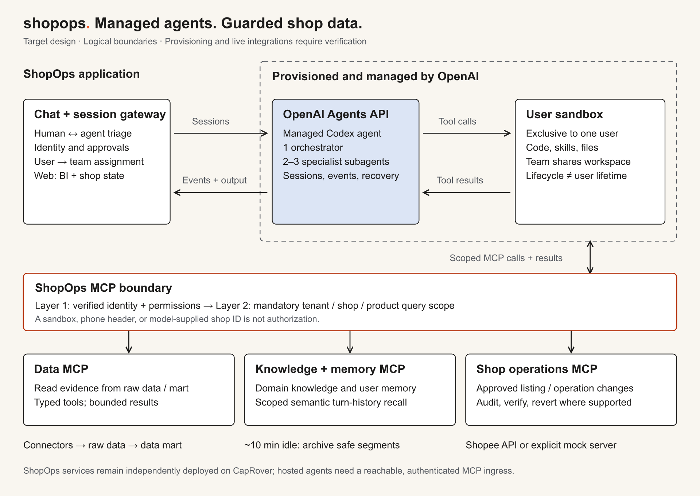

# Clarity in the chaos.

**Your next move, made clear.** ShopOps is a Telegram-first AI on-call agent for Shopee sellers: spot issues, triage them together in chat, choose an action, and check the result.

## Why ShopOps

Shopee sellers effectively run on-call operations manually. Seller Center provides data, but sellers still have to spot negative review spikes, loss-making vouchers, missed penalty points, and other threats to profit or account health themselves.

ShopOps serves small and mid-sized sellers in Vietnam: teams of **1–5 people handling around 20–500 orders a day**, usually without dedicated operations or data staff. Agencies managing multiple shops are the secondary audience.

## From signal to verified outcome

**Detect → Classify → Plan → Seller Chooses → Execute → Verify → Learn**

[Explore the product journey](docs/project-overview-pdr.md) · [Editable diagram](docs/assets/solution-loop.svg)

ShopOps connects reviews, orders, returns, cancellations, inventory, vouchers, payouts, fees, and penalty history. It groups related signals into an issue with evidence, a probable cause, severity, and urgency. In chat, the agent offers **2–3 actions** with expected impact, cost, risk, and reversibility. The seller chooses; ShopOps executes through an available Shopee API or an explicit mock server, then monitors success metrics and learns from the outcome.

Chat is the shared triage channel: the seller questions the agent's evidence, and the agent asks for context or a decision. The web client shows business intelligence and shop state after confirmed changes. Trust grows per issue and action: **suggest only → auto-execute with notification and rollback where supported → silent execution within explicitly pre-authorized limits**.

## Designed around managed agents and guarded data

[Read the architecture design](docs/system-architecture.md) · [Editable diagram](docs/assets/system-architecture.svg)

The product server requests on-demand provisioning at registration using `agent-core` as the reusable agents-service boilerplate. Each registered user is assigned a dedicated agent team: **one orchestrator and 2–3 specialists**, with an exclusive OpenAI-hosted sandbox for their work. The [Agents API](https://developers.openai.com/api/docs/guides/agents-api/architecture) runs the managed Codex harness; ShopOps owns identity, user-to-session assignment, tool permissions, and business decisions. A user's team is a durable application assignment; physical environments follow the provider's lifecycle.

MCPs connect agents to shop data, domain knowledge, memory, searchable past conversations, and controlled shop operations. Isolation has two boundaries: **an exclusive runtime per user**, plus **identity authorization and mandatory tenant/shop/product query scoping in the services**. A sandbox or an agent-supplied ID never grants access to another user's data. See [system architecture](docs/system-architecture.md).

Codex supports development through code generation, integration, and debugging, and selectively handles complex runtime tasks through the managed agent environment.

## Acknowledgments

With appreciation to **Sea Group and Shopee** for the seller ecosystem that inspired this project, and to **OpenAI** for Codex and the managed Agents API powering the proposed agent design.

## Explore the project

| Start here | Purpose |
| --- | --- |
| [Documentation guide](docs/README.md) | Find the owning document for a question |
| [Product and demo intent](docs/project-overview-pdr.md) | Seller problems, workflows, trust, and demo success |
| [System architecture](docs/system-architecture.md) | Managed runtime, MCP boundaries, lifecycle, and isolation |
| [Client setup](docs/client-workspace.md) | Run the existing independent web/chat clients and viewer |
| [Feature development](docs/feature-development.md) | Extend a service and verify its integration |
| [Deployment](docs/deploy-flow.md) | Shared monorepo CI/CD and CapRover deployment |
| [Brand kit](docs/brand/README.md) | Logos, colors, voice, and reusable assets |

## What runs today

The repository contains separate browser and Telegram-style web chat clients, a presentation viewer, operations/chat backends, and an agent-core foundation. **The architecture above is the target design, not a claim of a fully connected live system.** Actual Telegram delivery, per-user provisioning, semantic archival, the shop-write MCP, and live integration require implementation or acceptance evidence. Current setup and limits belong to the [client guide](docs/client-workspace.md) and [agent-core README](services/agent-core/README.md).

For local commands, use the owning service README under [services](services/) and read its `AGENTS.md` before editing. The hackathon keeps the architecture focused: prove a seller's issue-to-verified-action journey, show the isolation boundaries, and label mock versus live evidence honestly.
