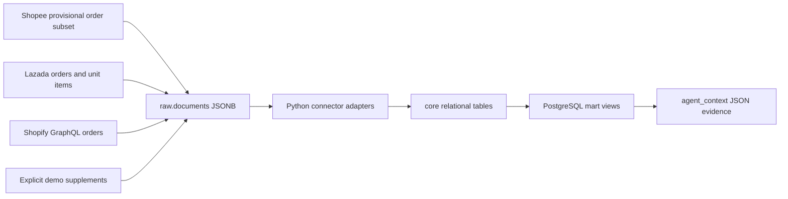

# Data guide

For every table, raw field, calculated metric and downstream workflow input, read the [field-by-field data dictionary](DATA-DICTIONARY.md).

To answer **which shops a logged-in user may access**, read the [user shop access guide](access/README.md).
The samples now include six users, two merchants, six memberships and ownership for all four shops.
Query `access.user_shop_access` with the backend's verified session user ID. All other reads must use
the same access join. The [access export](examples/raw-to-mart/access.json) shows allowed shops for
each demo user, including revoked, disabled and unassigned users.

For a seller problem traced end to end, choose a [use-case guide](examples/raw-to-mart/README.md): reviews, voucher losses, cancellations, returns, fees, payouts, stock, shipping, penalties or daily reporting. Each guide shows raw → core → mart → agent input → action examples → verification inputs. All field samples remain in the [complete reference](examples/raw-to-mart/reference.md). Run `npm.cmd run example` to reproduce the guides and JSON files.

## Scope for a half-day build

Implement three order connectors and one shared mart. Shopee and Lazada match the Vietnam marketplace use case; Shopify adds a substantially different GraphQL representation. The remaining operational entities use an explicit supplement contract so the team can demo the agent before getting marketplace access.

All amounts are VND in major currency units. Every fixture has 24 orders/day for 14 days. Shops `1001` on each platform contain incidents; Shopee shop `1002` is healthy. IDs deliberately repeat across shops and platforms to exercise composite keys. These are separate synthetic shops, not duplicated representations of one shop.

The clock is frozen at **2026-10-31 00:00:00 +07:00**. Recent window: October 29–30; baseline: October 17–28. Windows are `[start, end)`. Shipping, reviews, refunds, and payouts happen on the same day to compress the demo; these timings are not real marketplace SLAs or payout schedules. The scenario represents a snapshot, not a realistic settlement lifecycle.



## Files and layers

| Layer | Files / database | Purpose |
|---|---|---|
| Raw | Each platform's `raw/*.json`; `raw.documents` | Wrapper records source, shop, resource, capture time and schema confidence. `payload` contains the synthetic response subset or supplement. |
| Core | Each platform's `core/*.jsonl`; shared `core.*` tables | Typed, consistently named entities. Empty files mean no records, not a zero-valued measurement. |
| Mart | `mart/002_views.sql`; `mart.*` views | Reusable financial, review, inventory and operational metrics; deterministic candidates. |
| Handoff | `mart/agent-context.jsonl` | SQL-generated evidence packets for the next agent stage. No SQL connection needed to start agent work. |

Each raw order file is a large synthetic batch, not a claim about real API pagination limits. Lazada's `order_items.payload.responses` is a local bundle of individual response objects. Metadata wrappers and bundles belong to this project, not to the platform APIs.

## Core schema and grain

The authoritative types, checks and foreign keys are in [001_schema.sql](sql/001_schema.sql).

| Table | Grain / key (all entity IDs scoped to shop) | Main fields |
|---|---|---|
| `shops` | `shop_key = platform:source_shop_id` | platform, source ID, currency, timezone, capabilities |
| `products` | shop + SKU | name, unit cost, cost provenance |
| `orders` | shop + order ID | timestamps, normalized and original status, seller/platform discounts, promotion |
| `order_items` | shop + order + source line ID | SKU, quantity, unit price, line status |
| `reviews` | shop + review ID | order, SKU, timestamp, rating, Vietnamese text |
| `returns` | shop + return ID | order, request timestamp, reason, status, refund amount |
| `inventory` | shop + SKU + location + observation time | sellable quantity; `NULL` means unknown |
| `promotions` | shop + promotion ID | funding, start/end, name |
| `settlements` | shop + order ID | cumulative fee, seller shipping cost, refund, payout, paid timestamp |
| `fulfillment` | shop + order ID | shipping deadline, dispatch timestamp, deadline provenance |
| `account_health` | shop + event ID | incremental penalty points, reason, expiry |

`source_document_id` on every entity resolves to `raw.documents`. Orders also carry `enrichment_source_document_id` for supplemental discounts/promotion linkage. In a live connector, persist row-level source paths and immutable versioned responses as well.

Products represent variants, with unique SKUs required within a shop. Costs are constant for this demo; a real connector needs effective-dated costs per line. Settlements are cumulative order summaries, not ledger events; multiple statements/adjustments must be consolidated before loading. Health records are incremental penalties, not cumulative account snapshots.

## Mapping decisions

| Concern | Shopee | Lazada | Shopify |
|---|---|---|---|
| Order identifier | `order_sn` | `order_id` converted to text | full `gid://shopify/Order/...` |
| Timestamp | Unix seconds | date string with numeric offset | ISO-8601 |
| Item grain | `item_id:model_id`, quantity on line | one `order_item_id` per purchased unit | global line ID, quantity on line |
| Price | model discounted unit price, before order voucher in this fixture | `item_price` decimal string | `originalUnitPriceSet.shopMoney.amount` |
| Status | mapped enum | derived from item statuses; disagreements → `mixed` | cancellation first; `FULFILLED` → `shipped`, not proof of delivery |
| Seller-funded discount | demo supplement | order `voucher_seller` | `totalDiscountsSet.shopMoney.amount`, seller-funded by fixture assumption |
| Platform-funded discount | demo supplement | order `voucher_platform` | zero in this fixture; no subsidy modeled |

Unknown statuses map to `unknown`, never completed. Mixed/unknown orders are excluded from settled profit metrics pending explicit allocation. Marketplace refund states remain separate from fulfillment state. No cross-currency sums or inferred exchange rates are performed.

## Money semantics

```text
gross_sales          = sum(quantity × unit_price)
expected_payout      = gross_sales − seller_discount − fees − seller_shipping_cost − refunds
contribution_margin  = expected_payout − cost_of_goods
payout_variance      = actual_payout − expected_payout
```

Platform-funded discounts do not reduce seller revenue in this simplified model. The fixture assumes marketplace funding fully compensates that discount. Payouts exclude buyer shipping/tax pass-throughs; tax, advertising, packaging, recovered returned inventory and other adjustments are not modeled. `contribution_margin` is an operational estimate, not accounting net profit.

Refunds are subtracted once, from settlement totals; joining return records must not subtract them again. Returns count distinct orders, not units or refund transactions. Missing costs/fees produce unknown margins. Promotion loss indicates association; it does not establish that the voucher alone caused the loss, especially for refunded orders. Core money uses PostgreSQL `numeric(18,2)` and decimal strings in JSONL, avoiding binary floats.

## Rebuild and replay

Run these commands from `data_mock_sample`:

```powershell
npm.cmd install
npm.cmd run generate
npm.cmd test
npm.cmd run example
```

`generate` regenerates deterministic raw files, normalizes core files, and writes `.generated/seed.sql`.
It overwrites generated fixture files. To preserve hand-edited raw data, run `npm.cmd run normalize`
instead. Then reload with `load.sql` into a fresh dedicated demo database. Schema version 1.1 adds
access tables and required merchant ownership columns; `load.sql` does not migrate an older database.
The package pins PGlite for the existing PostgreSQL tests and exporters; Python uses the standard library.

The loader executes in one transaction and upserts by source keys. Replaying the same batch cannot duplicate counts. It does not delete rows removed from a fixture; use a fresh demo database when shrinking/changing scenario populations. It also does not provide historical state reconstruction: moving the mart clock backwards cannot recover older order states or costs. Live operation needs versioned snapshots/CDC, watermarks, late-arrival handling and schema migrations.

## Deliberate scenarios

| Scenario | Expected result |
|---|---|
| Shirt reviews repeat “chật / nhỏ / size” | One product issue combines negative-review spike and repeated sizing complaints |
| Seller discount grows to 90,000 VND per shirt | Negative contribution-margin promotion candidate |
| Cancellation rate rises from 1/24 to 6/24 | 25% recent rate for affected shops |
| More distinct orders request a return | Cohort return-rate candidate with maturity caveat |
| Effective fees rise from 5% to 15% | Fee-rate candidate |
| Two payouts per affected shop are short by 25,000 VND | Two order-specific reconciliation candidates per shop |
| Shirt stock falls to two sellable units | Less than two days of cover |
| Four orders remain unshipped past the demo deadline | One aggregated shipping-risk candidate per shop |
| Three active demo penalty points | Shopee/Lazada health candidate; Shopify capability is unsupported |
| Healthy Shopee shop | Zero candidates |

The current export contains **29 candidates**: ten each for Shopee/Lazada, nine for Shopify. Detection policies are explicit examples, not platform enforcement thresholds or statistically calibrated anomaly models.
