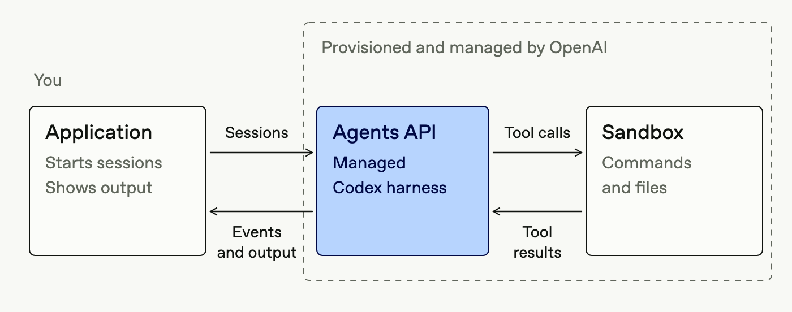

# Clarity in the chaos.

**Managed intelligence. A team tailored to your shop.**

ShopOps is a proactive AI operations companion for e-commerce merchants, starting with Shopee sellers. It is designed to help a busy team see what needs attention, understand its options and move toward a verified resolution - all through a conversation.

## The merchant problem

Orders and cancellations. Payouts and marketplace fees. Vouchers that eat into margins. A sudden rise in negative reviews, repeated complaints, penalty points or account-health risks. For a small team, these signals are scattered across a busy day; connecting them and deciding what to do takes time.

## From signal to a clearer next move

ShopOps is designed to spot issues early, gather evidence and explain what may be happening. Its agents can explore the context, offer practical options and ask the merchant for a decision. After an authorized action, the intended workflow checks the outcome and uses feedback to improve future recommendations. Previously approved actions could be automated within merchant-defined limits.

**Detect → Classify → Plan → Seller Chooses → Execute → Verify → Learn**

For example, repeated sizing complaints and a negative-review spike could become one investigation. The agent could explain the evidence, compare responses and invite the seller to choose. This is an illustrative journey, not a measured result.

**A simple start.** The intended experience meets the seller in Telegram, with a browser workspace for deeper evidence and shop state. Merchants can ask in everyday language or respond to an alert. The current chat is a Telegram-style web client; actual Telegram delivery remains future work.

## Isolation by design

The target design protects each merchant across four connected layers:

**Identity and sessions.** ShopOps resolves the authenticated user and owns the assignment to that user's private team and conversations.

**Agent team and environment.** Each user has a dedicated logical team and an isolated hosted environment; private working context is not shared between users.

**MCP access.** Each service independently checks identity and permissions before exposing tools or accepting a shop operation.

**Data layer.** Queries and operations are constrained to the authorized tenant, shop and applicable product. A sandbox alone never grants access to merchant data.

<!-- pagebreak -->

# A managed team, tailored to every merchant.

**Merchant agent as a service**

The proposed ShopOps architecture gives each registered user a dedicated logical team: one orchestrator and two or three specialists, working in an OpenAI-hosted environment. The shared product service owns identity, team assignment, sessions and merchant permissions; reusable agent-core connects it to the managed runtime. A separate backend deployment per merchant is not required.

*The application starts sessions and receives events; OpenAI manages the agent harness and its sandbox. Diagram illustrates the provider runtime boundary, not a completed ShopOps deployment.*

## Why this architecture matters

**Build faster.** The managed harness and hosted environment let developers concentrate on the merchant journey, agent instructions and integrations instead of building every runtime component from scratch.

**Designed to grow.** A reusable service can request isolated user environments on demand while maintaining durable user-to-team assignments. Capacity, cost and actual scale still depend on provider limits and end-to-end validation.

**Sessions with context.** The target design routes a merchant's conversation to the right team and receives events as work progresses. Agent reasoning can adapt to unfamiliar situations, use scoped tools and ask for missing context. Business identity, authorization and durable history remain ShopOps responsibilities; a sandbox alone does not grant access to shop data.

<!-- pagebreak -->

# Built to travel beyond one marketplace.

**One merchant experience. Adaptable connections.**

The same product pattern can serve merchants on other e-commerce platforms: retain the conversation, issue-to-resolution workflow and reusable agent foundation, then adapt the platform-specific data connectors, business rules, permissions and approved actions. Each marketplace needs its own API access, data mapping and integration testing; availability and capabilities vary. This is an extensible design, not a claim that those integrations are already live.

## How we built with Codex

Codex was the backbone of our development workflow. Multiple agents worked on bounded research, implementation and review. Fast mode supported rapid iteration; Goal supported long-running work; Plan mode helped refine the design before implementation. Dots helped us trace sessions, identify stalls and keep work moving. Developer documentation helped us set up and implement quickly.

## What exists today

The repository includes browser and Telegram-style web clients, API services, an agent-core foundation and a shop-data MCP implementation. The MCP is not yet deployed. Hosted per-user provisioning, end-to-end isolation, real Telegram delivery, live Shopee access, shop-write integration and hosted acceptance remain work to complete or verify. Mock and synthetic data do not prove live marketplace access or business outcomes.

## Build direction

**Autonomous & Adaptive AI** is the primary fit: ShopOps aims to investigate changing signals and act within merchant-defined permissions. Conversational triage also supports **AI-Native Products & Operations**, while commerce-specific evidence and decisions bring **Deep Domain AI** to everyday operations.

*Built for the Sea × OpenAI Regional Codex Hackathon - Vietnam. ShopOps serves Shopee merchants; Shopee hosts the event and judges the hackathon.*
