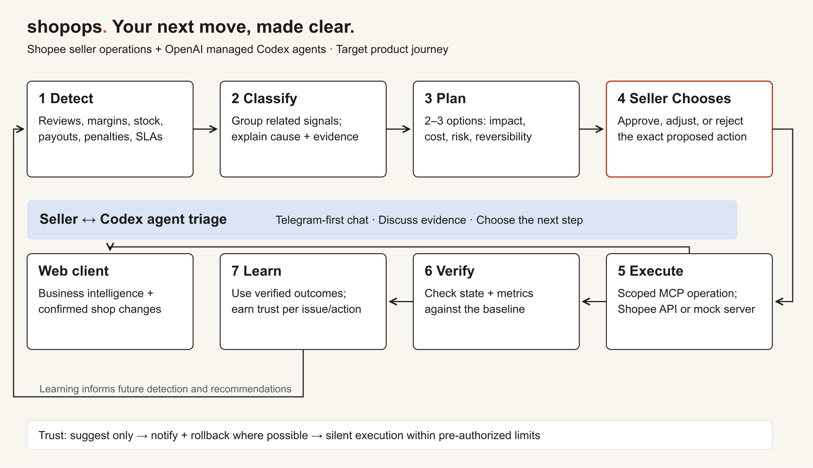
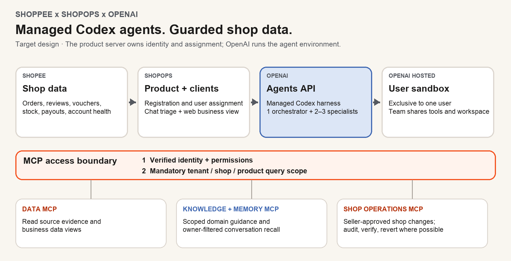

# ShopOps

**Your next move, made clear.**  
*Sea × OpenAI Regional Codex Hackathon · Vietnam*

ShopOps is an AI operations companion for Shopee sellers. It helps small teams spot issues early, decide what to do, and check whether the response worked.

## 1. The problem

Small and mid-sized Shopee sellers often act as their own operations team. Seller Center provides data, but sellers must manually notice negative-review spikes, unprofitable vouchers, rising returns, stock risks, late-shipment threats, or account penalties. With teams of one to five people and roughly 20–500 daily orders, issues can go unnoticed until they cost profit or harm shop health.

## 2. The solution we built

ShopOps brings a Telegram-style chat client together with a browser workspace for business intelligence and shop state. The product is designed around a shared seller–agent triage loop:

**Detect → Classify → Plan → Seller Chooses → Execute → Verify → Learn**

The agent groups shop signals into an evidence-backed issue, then presents two or three actions with their expected impact, cost, risk, and reversibility. The seller chooses or adjusts an option in chat. ShopOps can carry out an approved action through an available Shopee API or an explicitly labelled mock, check the resulting shop state and success metrics, then use verified outcomes to improve future recommendations. Autonomy grows by issue and action, within seller-approved limits.

**Prototype status:** The repository includes separate browser and Telegram-style web clients, a presentation viewer, API services, and an agent-core foundation. Actual Telegram delivery, registration-based per-user hosted provisioning, automatic live Shopee data access, and the shop-write integration still require implementation or live acceptance evidence. Mock and synthetic data do not establish live marketplace access.

<!-- pagebreak -->

## 3. Build direction

**Primary fit — Autonomous & Adaptive AI.** ShopOps is an operations agent designed to investigate changing real-world signals, act within explicit permissions, verify outcomes, and earn trust over time rather than require constant oversight.

It also aligns with **AI-Native Products & Operations**, because chat-based triage and agent workflows shape how sellers run daily operations, and **Deep Domain AI**, because useful recommendations depend on the details of Shopee commerce: reviews, vouchers, fulfillment, inventory, payouts, and account health.

## 4. How we used Codex

We used Codex as an engineering partner to explore the architecture, implement and connect client and service workflows, debug integration issues, and refine the project documentation. We also delegated bounded research and implementation work to specialist agents, then integrated and reviewed their results.

At runtime, the target design uses the OpenAI-managed Codex Agents API: one orchestrator coordinates two or three specialists in an environment dedicated to each registered user. ShopOps owns identity, team assignment, and business permissions. MCP services provide scoped access to Shopee data, knowledge, memory, and approved shop operations. The managed per-user runtime and live MCP/shop integrations remain target architecture until verified end to end.

The design protects data twice: authenticated identity and permissions are checked at the service boundary, and every data query is constrained to the authorized tenant, shop, and product. OpenAI hosts the agent runtime; Shopee supplies the seller's commerce context and authorized operations.

---

*Built for the Sea × OpenAI Regional Codex Hackathon — Vietnam. ShopOps serves Shopee merchants; Shopee hosts the event and judges the hackathon.*
