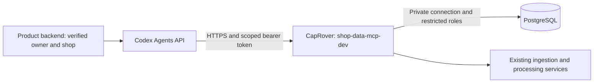

# Shop Data MCP configuration contract

Updated: 2026-10-31. Status: design contract; the service and settings below are not implemented yet. Use the [implementation plan](../plans/261031-shop-data-mcp/plan.md) to track readiness. This document owns deployment configuration; the [design report](../plans/reports/research-20261031-data-mcp-design.md) owns analytical behavior and protection requirements.

## Confirmed topology

The first deployment is dev only. OpenAI's Codex Agents API connects to an authenticated public HTTPS MCP endpoint. PostgreSQL remains private on the VPS.



Proposed service: `shop-data-mcp`, Python FastAPI template, container port `8000`, MCP path `/mcp`, image `ghcr.io/swe-squad/shop-data-mcp`. The endpoint will be `https://shop-data-mcp-dev.cr.ngochoanielts.com/mcp` after deployment. These are planned identifiers, not claims of running infrastructure.

## Runtime settings to implement

Declare these non-secret names with placeholder values in the future service's `.env.example`, validate them at startup, and document them in its README. Real credentials belong in CapRover App Configs or the deployment's secret manager. Never commit a populated dotenv file.

| Setting | Meaning / validation |
|---|---|
| `PORT` | `8000`; must match `service.json` and CapRover Container HTTP Port |
| `MCP_PUBLIC_URL` | Dev HTTPS endpoint above; used for identity/metadata, never as a database address |
| `DB_HOST`, `DB_PORT`, `DB_NAME` | Private PostgreSQL host, `5432`, target database; required with no dev fallback |
| `DB_CONTROL_USER`, `DB_CONTROL_PASSWORD` | Restricted service metadata connection; cannot be used to execute model SQL |
| `DB_QUERY_CREDENTIAL_REF` | Backend-only credential source for shop-bound query connections; resolver must be specified before enabling queries |
| `DB_WORKSPACE_USER`, `DB_WORKSPACE_PASSWORD` | Restricted writer for service-managed result storage; no raw-table access or model SQL execution |
| `DB_SSLMODE`, `DB_SSLROOTCERT` | Certificate-verified connection (`verify-full`) and mounted CA path; startup rejects missing trust material |
| `AUTH_ISSUER`, `AUTH_AUDIENCE`, `AUTH_JWKS_URL` | Trusted token issuer, MCP audience and HTTPS verification-key endpoint; required before exposing MCP |
| `INGESTION_URL`, `PROCESSING_URL` | Required runtime service URLs for fresh-pull integration; resolve actual service names before deployment |
| `APPROVAL_URL` | Trusted raw-access approval service URL; not callable as an agent approval tool |
| `QUERY_TIMEOUT_MS` | Proposed initial `10000`; enforce in PostgreSQL and worker cancellation |
| `MAX_CONCURRENT_QUERIES_PER_SHOP` | Proposed initial `2`; also cap global concurrency for VPS capacity |
| `MAX_RESULT_ROWS`, `MAX_RESULT_BYTES`, `WORKSPACE_MAX_BYTES_PER_SHOP` | Required positive operator-set budgets; enforce before materialization and output |
| `TEMP_MART_TTL_SECONDS` | Proposed initial `3600`; never exceeds any source grant expiry |
| `REFRESH_MAX_LOOKBACK_DAYS`, `REFRESH_COOLDOWN_SECONDS`, `REFRESH_MAX_CONCURRENT_PER_SHOP` | Required operator-set limits, enforced independently of the agent's requested scope |

Credential resolution must map verified shop identity to a limited execution login without allowing the model to supply a role name. The exact resolver is an implementation dependency; a shared unrestricted query credential is not an acceptable substitute. Migrations use an operator-controlled credential outside the running MCP service.

Internal service callers follow root [AGENTS.md](../AGENTS.md): actual callee-named URL variables must be added once service names are known. The generic adapter names above are proposed placeholders; replace them with the owning service's `<CALLEE>_URL` settings, rather than keeping duplicate aliases. Fail startup when enabled dependencies are missing. Do not silently use fixtures or mark a partially configured deployment ready.

## Connect the MCP to PostgreSQL

1. Determine the real PostgreSQL app/private hostname, version, schema and TLS capability. In the same CapRover cluster, use `srv-captain--<postgres-app-name>:5432`. On another VPS/network, establish a private route and firewall permission before configuring the host. `localhost` inside the MCP container refers to that container.
2. Keep database port 5432 unpublished. If PostgreSQL runs in CapRover, select **Do not expose as web app** and add no Port Mapping. Limit database/network access to the required service identities and network ranges.
3. Provision non-owner, non-superuser roles without `BYPASSRLS`, source write or role-changing privileges. Separate control metadata, shop-bound query and workspace writer access. Apply and verify RLS on every shared source and materialized mart surface.
4. Provision a server certificate whose identity matches the configured database hostname and mount its CA into the MCP container. Set `DB_SSLMODE=verify-full`. A private hostname alone does not enable or verify TLS; do not downgrade automatically if certificate verification fails.
5. Configure the settings above in the MCP app. Restart/redeploy and inspect sanitized readiness status. Test from the deployed container/network, not only a laptop.

Do not use an administrator URL for model queries. SQL restrictions, safe view ownership, raw grant projection and result isolation must be verified before accepting agent traffic. RLS does not protect against a privileged database account bypassing it. See [PostgreSQL RLS](https://www.postgresql.org/docs/current/ddl-rowsecurity.html).

## Connect the Agents API to MCP

The product backend verifies owner/shop membership, obtains a short-lived scoped MCP token from the trusted issuer, and creates the Agents API session. The MCP checks signature, issuer, audience, expiry, revocation and shop/agent binding for every call. Token claim names and token renewal must be agreed with the identity service. A caller-provided tenant header or tool argument cannot change authorization.

Add this proposed MCP entry to `agent.tools`, supplying `transport.authorization` at session creation from the trusted backend:

```json
{
  "type": "mcp",
  "server_label": "shop_data",
  "transport": {
    "type": "http",
    "server_url": "https://shop-data-mcp-dev.cr.ngochoanielts.com/mcp",
    "authorization": "Bearer <short-lived-shop-scoped-token>"
  },
  "connection_origin": "service",
  "required": true
}
```

Do not put the token in instructions, prompts, tool arguments, source files or sandbox environment variables. Per-session HTTP authorization is supported; reusable service-origin credentials can alternatively use an attached vault. Verify renewal for sessions outliving a token. Essential tools must remain accessible when optional protocol features are unavailable. Source: [official Agents API MCP connection and authentication guide](https://developers.openai.com/api/docs/guides/agents-api/tools/mcp).

Raw access still requires verified owner approval. Fresh pulls run automatically within policy. A refresh returns job/coverage metadata and does not authorize disclosure of collected raw payloads. Temporary marts inherit their sources' restrictions and expiry.

## CapRover and CI setup

Create app `shop-data-mcp-dev`; set Container HTTP Port to `8000`; enable HTTPS and Force HTTPS for its domain; add no Port Mapping. Set runtime configuration before accepting traffic. The reverse proxy must preserve MCP request/response headers and support streaming responses without buffering/timeouts that truncate calls. Verify actual client/server protocol compatibility rather than assuming the newest specification is supported by both SDKs.

Run the repository's `scripts/setup-service.sh shop-data-mcp dev` from your terminal with `CAPROVER_SERVER`, `APP_NAME_DEVELOP=shop-data-mcp-dev` and `CAPROVER_TOKEN_DEVELOP` supplied securely. This creates the service's dev deployment secrets under `codex-sea-dev`; it does not configure database or authentication settings. See [deployment guide](deploy-flow.md) and the current [new-service skill](../.agents/skills/new-service/SKILL.md). Do not send tokens in chat. Production deployment will fail until its app and `_PROD_` secrets are provisioned; dev-only approval does not configure production.

## Release checks and failure handling

- Unauthenticated, expired, wrong-audience and revoked requests fail without revealing catalog/data.
- A shop-A identity cannot discover or query shop-B data, results, workspaces or grants. Repeat after pooled-connection reuse.
- Raw queries fail before approval; raw-derived temporary marts fail after grant expiry/revocation.
- Malicious SQL cannot change roles/settings, invoke file/network functions, modify sources or use a privileged materializer.
- Query/result/workspace quotas stop excessive workloads. Database disconnection and certificate errors produce sanitized failures.
- Retried refreshes deduplicate; incomplete collection/processing never reports the mart as fresh.
- A real Agents API session lists tools and completes an authorized query; no credentials/private payloads appear in application logs.

Until these checks pass, configuration is documented but deployment is not verified. Roll back the image through CapRover, disable agent traffic and revoke affected MCP credentials when isolation/authentication checks fail. Restore backups only through a separately approved database recovery operation; an image rollback must not mutate source data.

## Integration reminders

Before implementing live adapters, remind the owner to supply ingestion and processing job contracts, their authentication methods, freshness/watermark semantics and idempotency behavior. Before enabling raw access or external traffic, remind the owner to supply verified owner identity, token issuance/renewal/revocation and raw-approval callback contracts. These integrations do not exist yet as of 2026-10-31; do not replace them with self-approval or fake success. These are workflow checkpoints, not scheduled notifications.
