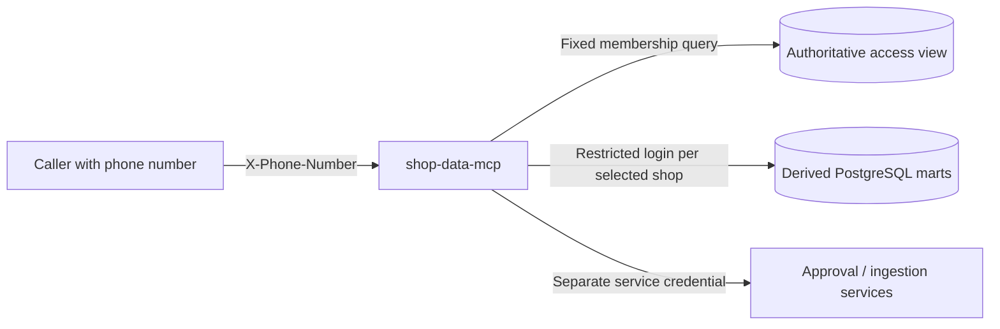

# Shop Data MCP configuration contract

Updated: 2026-10-31. Status: implemented configuration contract; live deployment is not verified. Use the [implementation plan](../plans/261031-shop-data-mcp/plan.md) to track readiness. This document owns deployment configuration; the [design report](../plans/reports/research-20261031-data-mcp-design.md) owns analytical behavior and protection requirements.

For PR #6 integration, follow the [pipeline integration guide](../services/shop-data-mcp/INTEGRATION.md).
It supplies the actual derived-database projections, role provisioning, cronjob bearer bridge,
snapshot status semantics and internal agent connection settings. Use `CRONJOB_SERVER_URL`
for the private cronjob origin and `MCP_INTERNAL_URL` to allow the MCP app's internal host.
The older range-refresh contracts below do not describe PR #6's full-snapshot refresh.

## Phone access contract

The caller sends `X-Phone-Number` on every `/mcp` request. The number must match the
source database's `user_id`, in canonical international format: `+` followed by 8-15
digits, with a nonzero first digit. JWT, API keys and OTP are not required. Anyone
knowing a user's phone number can access that user's configured shops; this is
identification by supplied number, not verified phone ownership.

The server looks up `access.user_shop_access` on every request and intersects its shop
keys with the configured `shops`. Unknown, inactive, revoked and unassigned users get
`401`; an unavailable membership database gives `503`. No phone goes in a URL or tool
argument, and proxies/applications must not log the phone header. `/health` needs no
phone. OAuth protected-resource metadata is no longer advertised.



Container port: `8000`; MCP endpoint: `/mcp`. Dev public URL:
`https://shop-data-mcp-dev.cr.ngochoanielts.com/mcp`. This describes the implementation,
not a verified deployment.

## Implemented runtime configuration

Set `MCP_CONFIG_FILE` to an operator-owned mounted JSON file and `MCP_CATALOG_FILE` to the separate dataset catalog; `PORT` defaults to 8000. Alternatively, supply the complete objects through `MCP_CONFIG_JSON` and `MCP_CATALOG_JSON`. Choose FILE or JSON for each source, never both; remove unused variables rather than leaving them empty. Existing inline catalogs remain supported when neither separate catalog source is set. `INGESTION_TOKEN` overrides JSON `ingestion_token`; the individual DB/AUTH environment names from earlier proposals remain unimplemented. See the [CapRover environment setup](../services/shop-data-mcp/README.md#caprover-configuration-through-environment-variables). The authoritative keys and defaults are in [runtime config example](../services/shop-data-mcp/config.example.json), [catalog example](../services/shop-data-mcp/catalog.example.json), and [DE development guide](../services/shop-data-mcp/DEVELOPMENT.md).

The JSON config defines restricted control/membership/query DSNs, shop dataset allowlists, server-controlled scopes, resource limits, and optional fixed ingestion/approval origins with separate credentials. Keep populated configuration outside Git. All three types of DSN require `sslmode=verify-full` and a mounted CA. The control identity stores artifacts and operation records but never executes model SQL; per-shop logins execute those queries.

Run `python -m app.check` for configuration validation and add `--connect` to check control storage, membership lookup and published mart connectivity. These checks do not certify tenancy policies or live upstream behavior. With the split examples, mount the runtime JSON, catalog JSON and CA and set both file variables before starting the service. Legacy inline catalogs need only `MCP_CONFIG_FILE` and the CA; leave `MCP_CATALOG_FILE` unset.

## Connect the MCP to PostgreSQL

1. Determine the real PostgreSQL app/private hostname, version, schema and TLS capability. In the same CapRover cluster, use `srv-captain--<postgres-app-name>:5432`. On another VPS/network, establish a private route and firewall permission before configuring the host. `localhost` inside the MCP container refers to that container.
2. Keep database port 5432 unpublished. If PostgreSQL runs in CapRover, select **Do not expose as web app** and add no Port Mapping. Limit database/network access to the required service identities and network ranges.
3. Provision non-owner, non-superuser query roles without `BYPASSRLS`, source write or role-changing privileges. Keep the control/workspace writer separate from shop-bound query identities. Apply and verify RLS on every shared source and materialized mart surface.
4. Provision a server certificate whose identity matches the configured database hostname and mount its CA into the MCP container. Set `sslmode=verify-full sslrootcert=<CA-path>` in the DSNs. A private hostname alone does not enable or verify TLS; do not downgrade automatically if certificate verification fails.
5. Mount the runtime JSON, catalog JSON and CA. Set `MCP_CONFIG_FILE` and `MCP_CATALOG_FILE` to their respective mounted files in the MCP app. For a legacy inline catalog, mount the runtime JSON and CA, set only `MCP_CONFIG_FILE`, and leave `MCP_CATALOG_FILE` unset. Restart/redeploy and inspect sanitized readiness status. Test from the deployed container/network, not only a laptop.

Do not use an administrator URL for model queries. SQL restrictions, safe view ownership, raw grant projection and result isolation must be verified before accepting agent traffic. RLS does not protect against a privileged database account bypassing it. See [PostgreSQL RLS](https://www.postgresql.org/docs/current/ddl-rowsecurity.html).

## Membership database setup

Apply [003-phone-membership.sql](../services/shop-data-mcp/migrations/003-phone-membership.sql)
**once in the authoritative source database**, then set the login password out of band.
The role can read only `user_id` and `shop_key` from `access.user_shop_access`. Set
`membership_dsn` to that login with verified TLS. The view must filter inactive users,
merchants and memberships; do not point at a delayed pipeline copy of the access graph.
No model-generated SQL runs through this login. It receives no source-record access.

This relies on the existing view contract in the source schema. PostgreSQL evaluates a
regular view when queried; see [CREATE VIEW](https://www.postgresql.org/docs/current/sql-createview.html).

## Caller example

Configure the MCP client's custom HTTP headers with:

```json
{"X-Phone-Number": "+84900000001"}
```

Use the caller's `SHOP_DATA_MCP_URL` runtime variable:

- Local: `http://localhost:8000/mcp`
- CapRover dev: `http://srv-captain--shop-data-mcp-dev:8000/mcp`
- CapRover production: `http://srv-captain--shop-data-mcp:8000/mcp`
- External callers: the configured public HTTPS endpoint.

Initialize the connection using the normal
[MCP Streamable HTTP handshake](https://modelcontextprotocol.io/specification/2025-11-25/basic/transports),
with the phone header on initialize, notifications and subsequent calls. A client that
only supports OAuth/Bearer credentials needs an adapter or custom-header support for this contract.

First call `list_shops` (paginated, 50 per page). Then call data tools with a selected
`shop_key` from that list. Example tool-call messages:

```json
{"jsonrpc":"2.0","id":2,"method":"tools/call","params":{"name":"list_shops","arguments":{}}}
```

```json
{"jsonrpc":"2.0","id":3,"method":"tools/call","params":{"name":"query_mart","arguments":{"shop_key":"lazada:1001","query":"SELECT sum(gross_sales) AS sales FROM order_economics"}}}
```

The same phone/connection can access several shops. Repeat queries with each authorized
shop key; this is not a combined cross-shop SQL engine. All data tools accept `shop_key`;
omitting it is valid only when exactly one configured shop is authorized. Saved results,
raw grants and refresh receipts stay bound to both phone and shop. Query responses include
`shop_key` so callers can associate each result with its source shop.

Capabilities come from the operator's `scopes` config, default `['data:read']`. Enable
`data:refresh` for collection and `raw:request`/`raw:read` for the approval workflow only
when the corresponding integrations are configured. The caller cannot choose scopes.
Raw access still requires verified owner approval; knowing the phone does not approve a grant.

## Migrating from JWT

1. Provision the membership login above. Add `membership_dsn` and, if needed, `scopes`
   to the mounted runtime JSON. Remove `issuer`, `audience` and `jwks_url`; those keys
   are no longer accepted. Keep `public_url` for host/origin validation.
2. Update callers to send `X-Phone-Number` instead of `Authorization: Bearer <JWT>`.
   Use `list_shops` and pass `shop_key` to data tools for multi-shop users.
3. For refresh, update cronjob's `MCP_SUBJECT_USERS_JSON` to map each phone to the
   corresponding source user, e.g. synthetic `{"+84900000001":"+84900000001"}`. Keep
   the separate MCP-to-cronjob service token. Approval integrations must also accept
   the phone subject and continue verifying owner consent independently.
4. Existing results, grants and refresh receipts owned by old JWT subjects do not
   transfer automatically. Finish/reconcile old in-flight operations before cutover;
   create new results and approvals under the phone subject. Never bulk-reassign them.
5. Restart with the new image/config and verify the release checks below. The legacy
   `revoked_tokens` table is retained for rollback but no longer consulted. Revoke
   access by disabling source membership/user/merchant, not by inserting a JWT ID.

Rollback requires the previous image, previous issuer configuration and previous caller
headers together. Existing business data and legacy control records are not dropped.

## CapRover and CI setup

Create app `shop-data-mcp-dev`; set Container HTTP Port to `8000`; enable HTTPS and Force HTTPS for its domain; add no Port Mapping. Set runtime configuration before accepting traffic. The reverse proxy must preserve MCP request/response headers and support streaming responses without buffering/timeouts that truncate calls. Verify actual client/server protocol compatibility rather than assuming the newest specification is supported by both SDKs.

Run the repository's `scripts/setup-service.sh shop-data-mcp dev` from your terminal with `CAPROVER_SERVER`, `APP_NAME_DEVELOP=shop-data-mcp-dev` and `CAPROVER_TOKEN_DEVELOP` supplied securely. This creates the service's dev deployment secrets under `codex-sea-dev`; it does not configure database or authentication settings. See [deployment guide](deploy-flow.md) and the current [new-service skill](../.agents/skills/new-service/SKILL.md). Do not send tokens in chat. Production deployment will fail until its app and `_PROD_` secrets are provisioned; dev-only approval does not configure production.

## Release checks and failure handling

- Missing, malformed, duplicate, unknown and inactive phone requests fail without revealing catalog/data.
- One phone can select all its configured shops, but cannot select unauthorized shops or access another phone/shop's results. Revoked membership blocks subsequent requests.
- Raw queries fail before approval; raw-derived temporary marts fail after grant expiry/revocation.
- Malicious SQL cannot change roles/settings, invoke file/network functions, modify sources or use a privileged materializer.
- Query/result/workspace quotas stop excessive workloads. Database disconnection and certificate errors produce sanitized failures.
- Retried refreshes deduplicate; incomplete collection/processing never reports the mart as fresh.
- A real client sends the custom header, lists shops and completes an authorized query; no phone headers or private payloads appear in logs.

Until these checks pass, configuration is documented but deployment is not verified. Roll back the image through CapRover, disable agent traffic and disable affected memberships when isolation/authentication checks fail. Restore backups only through a separately approved database recovery operation; an image rollback must not mutate source data.

## Integration reminders

Before implementing live adapters, remind the owner to supply ingestion and processing job contracts, their authentication methods, freshness/watermark semantics and idempotency behavior. Before enabling raw access or external traffic, remind the owner to supply the live membership view/connection and raw-owner approval callback contracts. These integrations do not exist yet as of 2026-10-31; do not replace them with self-approval or fake success. These are workflow checkpoints, not scheduled notifications.
