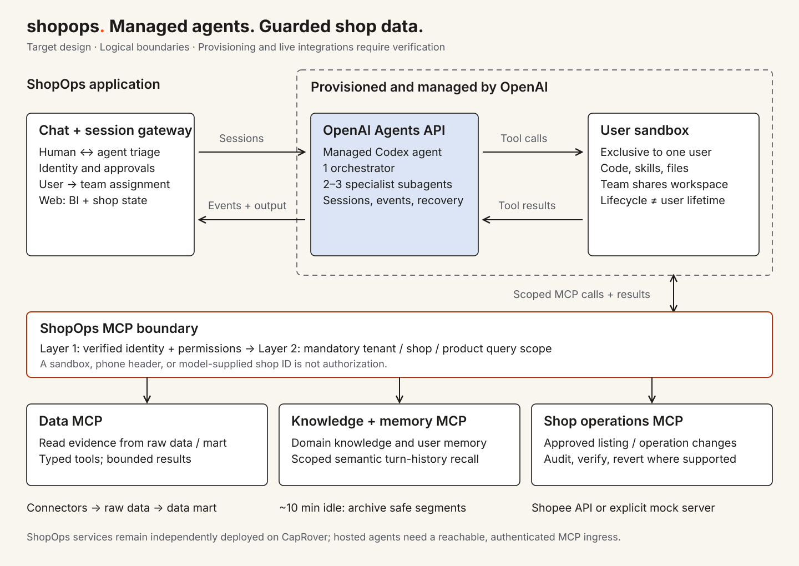

# ShopOps system architecture

This is the confirmed target design. [Product overview](project-overview-pdr.md) owns seller outcomes; [client setup](client-workspace.md) and [service integration](service-integration-pattern.md) describe existing integration. A design boundary is not evidence that its live integration is complete.

## Managed runtime, dedicated to each user

Each registered user receives a dedicated logical agent team: **one orchestrator and 2–3 specialist subagents**, in OpenAI-hosted session/sandbox environments reserved for that user. Different users never share a live team, session, sandbox, or private working memory. Specialists within one team share that team's workspace; specialization is not a separate sandbox boundary.

The selected runtime is the **OpenAI-managed Codex Agents API**. ShopOps supplies authenticated input, consumes events, assigns sessions, and enforces business permissions. OpenAI runs the agent harness, including orchestration and context management. See the official [Agents guide](https://developers.openai.com/api/docs/guides/agents) and [runtime architecture](https://developers.openai.com/api/docs/guides/agents-api/architecture).

Registration establishes the user's logical team with duplicate-safe provisioning. This does not require a permanently running container. Configuration templates may be reused; live user environments may not. OpenAI's [hosted sandbox lifecycle](https://developers.openai.com/api/docs/guides/agents-api/environments/openai-hosted) is separate from durable conversation history, so required memory and business evidence live outside transient workspace files. Replacement restores only the owner's authorized context.

Per-user team ownership supersedes the earlier per-shop orchestrator assumption in agent-core's starter requirements. That is an intentional target change; existing provisioning contracts require reconciliation before integration.

## Product server and agent boilerplate

The product server owns authenticated registration, user identity, and the durable user-to-team
assignment. When a user registers, it requests on-demand team provisioning through the reusable
`agent-core` agents-service boundary. The boilerplate supplies agent configuration, provider
integration, and session/MCP capabilities; OpenAI provisions and runs the hosted environment.
There is no separate CapRover agent-core deployment for each user.

Registration retries reuse the logical assignment or reconcile a pending attempt. They must not
spawn a second team after an uncertain provider response. Team assignment is durable even when a
physical session/environment needs replacement. The [integration checklist](agent-integration.md)
defines what returning engineers must verify; it does not invent a new registration endpoint or
claim the current shop-scoped provisioning contract already implements this design.

## Responsibilities

The eight sketch entries describe responsibility boundaries, not a commitment to eight separate deployments.

| Responsibility | Purpose |
| --- | --- |
| Pull data | Ingest authorized shop data with source and freshness evidence. |
| Raw data | Retain source records for traceable investigations. |
| Data mart | Provide derived business views linked to source evidence. |
| Data MCP | Offer scoped reads over raw data and marts through bounded tools. |
| Agents environment | Run the user's orchestrator, specialists, code, skills, and tools. |
| Shop interaction | Perform controlled mutations through the planned Shop Operations MCP. |
| Chat client | Support mutual triage, clarification, decisions, and progress through managed sessions. |
| Web app client | Show BI, evidence, shop state, and confirmed operation results. |

Memory, domain knowledge, and history are accessed through scoped MCP capabilities. Shared domain guidance and private user memory have different access rules. The orchestrator owns the coherent response and delegates bounded tasks; specialist completion never proves that a shop action succeeded.

## Two independent isolation boundaries

**Runtime boundary:** ShopOps resolves user-to-team/session ownership from authenticated identity. A client or model cannot choose another user's environment. Shared shop access never implies shared private conversations or runtime context.

**Data boundary:** Each MCP/service verifies the caller's identity and capability. Its repository queries additionally constrain tenant, authorized shop, and applicable product scope. User/model identifiers may narrow that scope; they cannot establish ownership or widen access. Missing or mismatched scope is rejected before reading or changing data.

The same boundary applies to semantic recall, artifacts, operation receipts, aggregates, and browser evidence links. An isolated sandbox can still ask for the wrong product. Service authentication and query scoping remain mandatory independently of runtime isolation. See [data and MCP design](data-and-mcp.md).

## Conversation, turns, and memory

The chat client communicates with the user's orchestrator through ShopOps' session gateway. The seller can question evidence or steer an investigation; the agent can ask for context or a decision. The web client reads authorized BI/shop state after confirmed changes rather than treating chat text as a completed mutation.

A provider **session** persists conversation state; a **turn** is a cycle of active work. ShopOps' proposed **roughly ten-minute inactivity window** closes a settled conversation segment for semantic archival. This is application policy, not the provider's turn-completion or sandbox-expiry rule. See [session semantics](https://developers.openai.com/api/docs/guides/agents-api/sessions).

Inactivity alone must not mark unfinished work complete, cancel a running agent, discard approval, or erase uncertainty. Archive issue context, evidence references, user decisions, attempted actions, and verified outcomes once active work has settled. Pending decisions remain explicit. Historical observations may inform a new investigation; historical approval never authorizes a new operation.

Archiving a segment does not require deleting the provider session. Continue an owned valid session or create a replacement and retrieve authorized history. Semantic retrieval must filter ownership before candidate retrieval and recheck returned resources; similarity is not permission.

## Controlled shop operations

Data MCP supplies evidence. The planned **Shop Operations MCP** is the business-write boundary.

1. Propose the exact shop/product changes with evidence, impact, risk, cost, reversibility, and success metrics.
2. Validate current grants and policy; bind required seller approval to that exact action and scope.
3. Recheck permission and relevant shop state immediately before execution; record a durable operation identity and attempt.
4. Execute through the authorized Shopee integration or explicitly identified mock server.
5. Persist a confirmed result or an explicit uncertain outcome. Reconcile interrupted attempts before retrying; never duplicate an uncertain mutation blindly.
6. Verify authoritative state and business metrics against the recorded baseline. A successful API request alone does not prove the business outcome.

Material proposal changes require renewed approval. Rollback is offered only where the integration and affected state permit reversal. Trust increases per issue/action within seller-defined limits, as specified in the [product overview](project-overview-pdr.md).

## Existing evidence and remaining integration

| Area | Existing owner | Target integration |
| --- | --- | --- |
| Clients | [Client workspace](client-workspace.md) | Telegram-first experience; actual Telegram transport remains separate from the current web chat. |
| Chat runtime | [Chat API](../services/shopops-chat-api/README.md) | Connect each user to their managed team; resolve agent-core ownership once. |
| Agent foundation | [Agent core](../services/agent-core/README.md), [contracts](../services/agent-core/contracts/README.md) | Reconcile per-user provisioning; live managed workflow acceptance remains pending. |
| Data MCP | [Data integration design](data-and-mcp.md) | Integrate the prototype with authenticated identity and scoped storage access. |
| Shop writes | [Operations integration](service-integration-pattern.md) | Build Shop Operations MCP and its approval/execution/verification path. |
| Identity and history | [Current access model](client-workspace.md) | Replace shared workspace access with registered-user grants; add semantic archival. |

Machine-readable contracts own implemented interfaces. Current offline fixtures do not prove live marketplace access, hosted isolation, or business impact.

## Keep the hackathon focused

Keep ShopOps-owned services on the existing [CapRover deployment route](deploy-flow.md). OpenAI-hosted execution needs a verified, authenticated path to MCP services: cluster-only CapRover addresses are not reachable automatically. A narrow ingress or application bridge must preserve identity and authorization; do not expose databases or publish every internal API.

Use one provisioning/session owner when connecting chat-api and agent-core. Before claiming the target works, demonstrate duplicate-safe provisioning, cross-user runtime denial, cross-shop/product query denial, scoped recall, interrupted-operation reconciliation, and evidence-backed verification. Label mock and live evidence separately.
