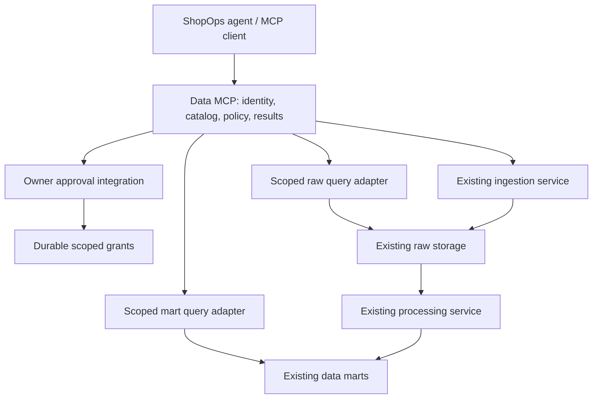

# ShopOps data MCP: proposed design

Research date: 2026-10-31, Asia/Ho_Chi_Minh. Revised with owner decisions: PostgreSQL on VPS, Codex Agents API, temporary ad hoc marts, automatic fresh pulls, data protection as priority. Status: proposed implementation design; no service scaffold or live integration implemented. Deployment decisions: public authenticated MCP HTTPS with direct OpenAI connection; private PostgreSQL; dev only. See the [configuration contract](../../docs/shop-data-mcp-configuration.md) and [validated implementation plan](../261031-shop-data-mcp/plan.md).

## Navigation

1. [Outcome and boundaries](#outcome-and-boundaries)
2. [Evidence and choices](#evidence-and-choices)
3. [Architecture and tools](#architecture-and-tools)
4. [Approval and isolation](#approval-and-isolation)
5. [Efficient analysis](#efficient-analysis)
6. [Delivery and open questions](#delivery-and-open-questions)

## Outcome and boundaries

**Outcome:** An authenticated shop agent discovers PostgreSQL data and its meaning, investigates arbitrary domain questions against marts, obtains owner approval for scoped raw-data investigations, builds temporary ad hoc marts, and automatically requests fresh collection through the existing ingestion service when necessary. Results remain traceable to data versions and freshness.

**Constraints:** Existing ingestion and processing services own their jobs and credentials. Shop authorization and escalation approval must be enforced outside the model. Multiple marts must be discoverable. Domain reasoning belongs to the agent; metric definitions and data capabilities come from the data layer. Existing fixtures are synthetic and do not prove live integration compatibility.

**Non-goals:** Selecting or replacing the existing ingestion/processing stack; implementing marketplace operational writes such as voucher changes; silently modifying raw records or published marts; embedding a second reasoning agent in the MCP.

**Acceptance criteria:** An agent answers a new analytical question without adding a tool; discovers a metric's grain and caveats; follows lineage into approved raw evidence; cannot cross shops or forge/replay/expand approval; submits one collection job despite retries; distinguishes collection completion from mart readiness; reports missing/unsupported data without treating it as zero; returns bounded evidence instead of dumping full tables. These criteria cover all three requested access levels.

## Evidence and choices

Repository evidence (historical inspection in the original checkout; `data_mock_sample/` is absent from this feature worktree and is an explicit schema/fixture dependency):

- `README.md` describes a Telegram-first operational agent with seller approval.
- `data_mock_sample/README.md` documents PostgreSQL raw/core/mart layers, composite shop keys, source-document links, synthetic data, unknown-value semantics and limited historical reconstruction.
- `data_mock_sample/mart/README.md` defines eight mart views, including order economics, inventory risk and review metrics. It explicitly says demo tenancy authorization/RLS is absent.
- `services/README.md` contains only a placeholder. No deployed ingestion API or processing API contract was located in the inspected documentation. Their existence is supplied by the user; their interfaces remain unknown.

Research scope: current official MCP protocol, discovery, structured results, approvals, asynchronous work and context efficiency. Database/vendor selection and Shopee endpoint selection are outside scope. No throughput or token benchmark is claimed for this service.

### Compared approaches

| Approach | Main assumption | First failure condition | Assessment |
|---|---|---|---|
| Fixed tools for every metric/report | Agent questions match known reports | New join, metric or investigative question requires another endpoint | Useful examples, too restrictive as the sole interface |
| General SQL/code over all data | Model and credentials reliably enforce scope | A query or function exposes another shop, protected raw data or filesystem/network access | Flexible but unacceptable as an unrestricted boundary |
| Discoverable semantics plus constrained queries and approved escalation | Stores expose a queryable, enforceably scoped surface | A backend cannot enforce scope or lacks required schema/lineage metadata | Recommended; adapters must declare capabilities rather than pretend equivalence |

**Better approaches:** none — the recommended layered approach implements the user's requested mart → approved raw → fresh collection direction. Existing lineage and mart contracts support that direction.

Evolution: the evidenced second cases are multiple marts and raw storage, which have different capabilities. Share identity, policy, job/result handles and provenance. Keep execution behind separate mart-query, raw-query and ingestion-service adapters. Do not invent a universal storage framework. A different mart should change its adapter and catalog entries, not the approval mechanism or agent-facing result contract.

### Current MCP implications

The current official revision resolves to **2026-07-28**. It changes discovery, per-request metadata, sessions and elicitation relative to 2025 examples. Use an SDK/client combination verified against that revision; support an older revision only if the chosen agent requires it. Tasks are now an opt-in extension. Application job IDs remain useful when Tasks are unavailable. Source: [official change log](https://modelcontextprotocol.io/specification/2026-07-28/changelog).

Use Streamable HTTP for the deployed service. Keep application jobs and grants durable independently of transport connections. Check actual host support before relying on protocol extensions. Source: [transport overview](https://modelcontextprotocol.io/specification/2026-07-28/basic/transports).

## Architecture and tools



Recommend service name `shop-data-mcp`: its responsibility spans shop operations and products. Recommend the repository's `python-fastapi` scaffold, subject to verifying official MCP SDK compatibility when implementing. The agent runs on the Codex Agents API. Direct service-origin connections require an OpenAI-reachable authenticated HTTPS endpoint; a private MCP can instead use environment-origin connections through a connected self-hosted environment. PostgreSQL remains private in either case. Production scope remains an owner decision. Source: [Agents API MCP connections](https://developers.openai.com/api/docs/guides/agents-api/tools/mcp).

Expose a small set of typed tools with explicit purpose and output schemas. Names below are proposed application contracts, not MCP standard method names.

| Tool | Role |
|---|---|
| `search_catalog` | Search authorized datasets, fields, metrics, joins, lineage and collection capabilities. Return concise matches and IDs. |
| `describe_dataset` | Load a selected schema, grain, definitions, valid joins, provenance, freshness and query examples. |
| `query_mart` | Execute a bounded, read-only analytical query over authorized marts. Return a small preview plus a result handle. |
| `request_raw_access` | Explain the evidence gap; propose a bounded investigation; create an owner approval request. Returns pending/denied/granted state. |
| `query_raw` | Query only the raw scope covered by a verified grant, with projection and limits. |
| `request_refresh` | Automatically submit a bounded resource/entity/time scope and freshness goal to the collector, subject to server-enforced policy. No per-pull confirmation. |
| `create_temp_mart` | Materialize a validated SELECT from permitted sources into a private, expiring investigation workspace. Raw-derived marts require a current raw grant. |
| `query_temp_mart` | Query an authorized temporary mart, rechecking its source grants and expiry. |
| `drop_temp_mart` | Release an owned temporary result and its dependencies through controlled cleanup. |
| `get_operation` | Inspect approvals, queries, collection and processing jobs; expose stages and errors. |
| `read_result` | Read a bounded page or projection from an authorized result handle. |

Resources can expose versioned dataset definitions, metric dictionaries and result artifacts for hosts that support them well. Keep discovery and result reading accessible through tools too, so essential work does not depend on the host automatically loading resources.

The catalog describes physical datasets and business meaning: grain, keys, safe join relationships, event vs ingestion timestamps, timezone, currency/unit, null semantics, observed capabilities, source lineage, retention and schema version. For example, contribution margin is not accounting net profit; a recent return cohort is less mature. The agent retains freedom to derive new calculations and labels its assumptions.

Core-layer views are available without escalation only if explicitly published as part of the authorized analytical surface; a missing mart field must not accidentally bypass raw approval through core access.

## Approval and isolation

Default mart access is granted by owner policy at agent setup. Raw access requires the explicit escalation requested by the user. Fresh collection is automatic by explicit owner decision, with server-enforced shop/resource/time/quota limits. Collection does not grant raw-reading permission. Materializing approved raw data does not remove its access restrictions.

1. The agent states why available data is insufficient, which sources/fields/entities/time range it needs, and the expected operation/cost boundary.
2. The server canonicalizes that proposal and creates a pending approval. No raw read or collector side effect occurs yet.
3. An authenticated owner approves via the existing product approval channel. Telegram identity must already map to the shop owner; a text claim of ownership is insufficient.
4. The server records a grant bound to owner, agent principal, shop, datasets, fields, time range, actions, budgets and expiry. A bounded investigation grant may allow several queries within the approved scope.
5. Every query and result read rechecks identity, current authorization, scope and grant validity. A handle alone is never authority. Revocation prevents further reads; it cannot retract evidence already delivered.
6. The agent cannot approve its own request. A boolean such as `confirmed=true` in tool arguments has no authority. Scope expansion needs another approval. Collection grants and raw-reading grants are distinct.

Elicitation can present a supported client UI, but approval must still bind to a verified identity. Use the product approval workflow as a fallback when the host lacks elicitation. Source: [MCP elicitation security and identity requirements](https://modelcontextprotocol.io/specification/2026-07-28/client/elicitation).

For remote interoperable clients, follow MCP HTTP authorization and validate token audience/issuer; internal service identity must still resolve delegated shop/owner scope. Source: [MCP authorization](https://modelcontextprotocol.io/specification/2026-07-28/basic/authorization).

SQL enforcement requires more than a SELECT prefix check: parse and resolve statements; restrict relations/functions; deny writes, external access and unsafe functions; impose execution, scan and output budgets; use least-privilege database roles and backend-enforced tenancy. PostgreSQL views require explicit testing that owner privileges do not bypass isolation. Never depend on the agent remembering `WHERE shop_key = ...`. Raw JSON/object storage needs equivalent server-side selection and projection. Catalog metadata and cached results must also be scoped.

Treat reviews, product descriptions and raw strings as untrusted data. Credentials stay in the owning services. Audit identity, scope, approval references, query fingerprints, result counts and job transitions without copying private row contents into ordinary logs.

## Efficient analysis

Load a compact catalog index, then only relevant schema details. Push aggregation, filtering, joins and projection to the query backend. Return typed structured results with compact previews and handles for larger artifacts. Use deterministic tool ordering and stable schemas. These recommendations follow [MCP tools](https://modelcontextprotocol.io/specification/2026-07-28/server/tools).

Suggested result envelope:

```json
{
  "status": "complete",
  "result_id": "res_opaque",
  "rows": [],
  "columns": [],
  "returned_rows": 0,
  "truncated": false,
  "next_cursor": null,
  "provenance": {
    "dataset_versions": [],
    "source_watermarks": [],
    "mart_processed_at": null
  },
  "quality": {"warnings": [], "missing_fields": []}
}
```

Actual envelopes also specify window, currency/timezone where applicable and effective limits. Source watermarks describe coverage, not merely the time a job ran. Distinguish empty, unsupported, incomplete, stale and failed states. Pagination must use a stable result/snapshot, and each result has an expiry and authorization binding. Cache keys include tenant, effective scope, query, schema/data version and approval constraints.

Server-side SQL covers substantial composition already. Where the host provides a secure code environment, it can compose MCP calls and process intermediate result handles without putting every row into model context. This is a host capability, not a reason to expose unrestricted Python/shell in the data service. A server computation sandbox is a later decision only if measured workloads require it. Source: [Anthropic's code-execution research](https://www.anthropic.com/research/code-execution-with-mcp).

Fresh-pull lifecycle: policy accepted → queued → collecting → raw available → processing → mart ready, with explicit failed/cancelled/partial states. Use idempotency keys bound to the canonical request, deduplicate overlapping pulls where supported, and surface collector rate limits. Do not report fresh marts just because collection finished. Propagate upstream job IDs and watermarks. If processing is not automatically triggered, an explicit processing-service adapter must request it after collection. Retries cannot silently widen the permitted time range.

Example: The agent investigates falling margin using order economics and promotion data. If an unknown fee component is absent, it requests access to the relevant settlement documents for the shop and period. If those documents are stale, it automatically requests a bounded refresh. After collection and processing, it reruns the comparison and reports source coverage, missing costs and the limits of causal inference.

## PostgreSQL protection and temporary marts

Threat boundary: the model can submit incorrect or adversarial SQL, raw text can contain prompt injection, and callers can guess handles or supply another shop ID. Protect data confidentiality, source integrity and VPS availability. Compromise of the VPS/root or the trusted MCP backend is outside query isolation and requires host hardening and recovery controls.

### Credentials and PostgreSQL roles

- The agent receives no PostgreSQL connection string, Shopee credential, database-admin tool or arbitrary shell in the data service. The product backend supplies a short-lived, shop-bound MCP credential outside agent-visible messages. Resolve owner, agent and shop from verified credentials, not tool arguments or an unverified tenant header.
- Migration, ingestion and processing credentials remain separate from query execution. Query roles are non-owner, non-superuser, without BYPASSRLS, role-management, replication, schema-creation or source-write permissions. Do not give one generic query role membership in every shop's roles.
- Prefer a shop-bound execution login/role whose identity maps to one shop at the database boundary for this deployment scale. Raw execution additionally uses approved, projected source surfaces restricted to the grant's datasets/fields/window. Trusted role provisioning never grants unfiltered raw tables just to run a user query.
- RLS must protect every shared source table, with missing identity denying access. Apply FORCE ROW LEVEL SECURITY where appropriate. Never use a mutable `app.shop_id` setting as the sole RLS trust anchor for arbitrary model SQL: settings and context-changing functions must be unavailable to submitted statements. Source: [PostgreSQL RLS](https://www.postgresql.org/docs/current/ddl-rowsecurity.html).
- Views must preserve isolation through the whole dependency chain. Use security-invoker views where appropriate and audit security-definer functions. Materialized mart tables require their own shop isolation; source-table RLS does not retroactively protect copied results. Source: [PostgreSQL view security](https://www.postgresql.org/docs/current/sql-createview.html).

SQL validation is a second boundary: one parsed SELECT, bound values, fully resolved allowed relations/functions, no data-modifying CTEs, role/context changes, system catalogs, file/network helpers, advisory locks or arbitrary functions. Read-only transactions do not make every SELECT safe. Fail closed on unsupported SQL shapes. Pin a safe search path and use schema-qualified relation names. Check pooled connections cannot retain another shop's identity, grants or temporary objects.

### Controlled temporary marts

Use service-managed expiring tables/result artifacts, not agent-issued CREATE/ALTER statements. PostgreSQL TEMP objects have connection lifetime, which does not match an investigation spanning stateless MCP calls and a connection pool. Source: [PostgreSQL temporary view lifetime](https://www.postgresql.org/docs/current/sql-createview.html).

`create_temp_mart` accepts a SELECT, source handles, purpose and requested lifetime. It first runs the SELECT with the same restricted source identity as a normal query. A separate trusted materializer stores that bounded result in a private investigation workspace. It must never execute the model SELECT with its privileged writer credentials. The writer only accepts server-generated identifiers and typed rows; the model cannot choose a destination schema or filesystem path.

Persist shop/agent/investigation ownership, canonical query, source versions, raw-grant dependencies, sensitivity and expiry. A raw-derived result inherits the raw grant's scope and an expiry no later than its dependencies. Joining another temporary result preserves the union of restrictions. Querying, paging, exporting or deriving another mart rechecks every dependency. Denial/revocation blocks subsequent reads immediately; asynchronous deletion follows. Previously delivered data cannot be recalled.

Allow aggregate outputs without a shop column, but enforce ownership on the containing artifact/workspace. Do not infer tenant isolation from an output column supplied by the query. Workspace objects are absent from other shops' catalog searches. They cannot be published into shared marts by this service.

Proposed initial operational defaults, to tune against the VPS: one-hour artifact lifetime; maximum lifetime bounded by source grants; two concurrent analytical jobs per shop; ten-second interactive query timeout; bounded result rows/bytes and workspace disk quota. Enforce timeouts, cancellation, row/byte limits and worker/container resource budgets. PostgreSQL `work_mem` is per operation, and `temp_file_limit` does not cap explicit temporary tables; neither is a complete workspace quota. Source: [PostgreSQL resource consumption](https://www.postgresql.org/docs/current/runtime-config-resource.html).

### Automatic refresh decisions

The catalog publishes source coverage/watermarks, expected update cadence, supported collector resources, historical windows and current jobs. The agent refreshes when the question requires newer coverage or absent records, choosing the smallest useful window and entities. The server independently enforces authorized shop, resource allowlist, maximum lookback, request/page/byte budgets, cooldowns and concurrency. Reuse a compatible in-flight job and reject unsupported resources with a recoverable explanation. No automatic fallback to a broader shop scope or full-history pull.

Collection may fetch protected fields into raw storage, but only authorized projected data can reach the agent. A collector response returns status and coverage metadata, not raw payloads. Completion triggers processing where supported; the agent waits for the relevant mart watermark rather than assuming freshness. If quota is exhausted, return current coverage and retry timing without repeated confirmation prompts.

### Deployment and information disclosure

Keep PostgreSQL off public ports; allow connections only from the necessary services on a private network, with authenticated encrypted transport across untrusted links. Expose only authenticated MCP HTTPS when using service-origin Agents API connections. Per-session MCP HTTP credentials can be provided outside the environment; the official documentation also describes environment-origin access for private networks. Do not put credentials into agent instructions, generated code or logs. Source: [Agents API MCP authentication and connection origins](https://developers.openai.com/api/docs/guides/agents-api/tools/mcp).

Mask buyer contact/address fields at the accessible projection before query execution; returning them then redacting the final answer is too late. Approved raw scope still respects the product's field-disclosure policy. Return minimal evidence to the hosted agent because MCP results enter its processing context. Keep audit events free of payloads; protect SQL/error traces that can contain literals. Restrict agent egress/tools to the product's needs so approved data cannot be uploaded through an unrelated integration. Encrypt backups, restrict backup access and verify restoration before relying on recovery. Credentials, disk encryption and backups require deployment verification; this document does not claim they are configured.

## Delivery and open questions

Next: follow the implementation plan and acquire the missing integration contracts before scaffolding live adapters. Implement all three paths with real adapters; use fixtures for deterministic verification and label them synthetic. Do not substitute fixtures for live-service integration claims.

Verification must include novel analytical queries, join-fanout mistakes, unsupported capabilities, cross-shop attacks, raw access through alternate relations, forged/expired/revoked grants, changed approval scope, unauthorized result-handle access, retry deduplication and collection/processing failures. Measure calls, tokens returned, latency and answer correctness on representative investigations before setting budgets. No runtime tests were run for this design-only report.

Open questions:

1. What PostgreSQL version/schema and ingestion/processing API contracts should implementation target? Engine is settled as PostgreSQL on VPS.
2. Where is the trusted owner identity/raw-approval workflow implemented? Agent host is settled as Codex Agents API.
3. Resolved: direct OpenAI connection over authenticated public HTTPS; PostgreSQL stays private.
4. Resolved: dev only. Temporary-only marts and automatic bounded refresh are settled. Ingestion/processing and owner identity/raw-approval integrations do not exist yet; remind owner before live implementation and deployment.
