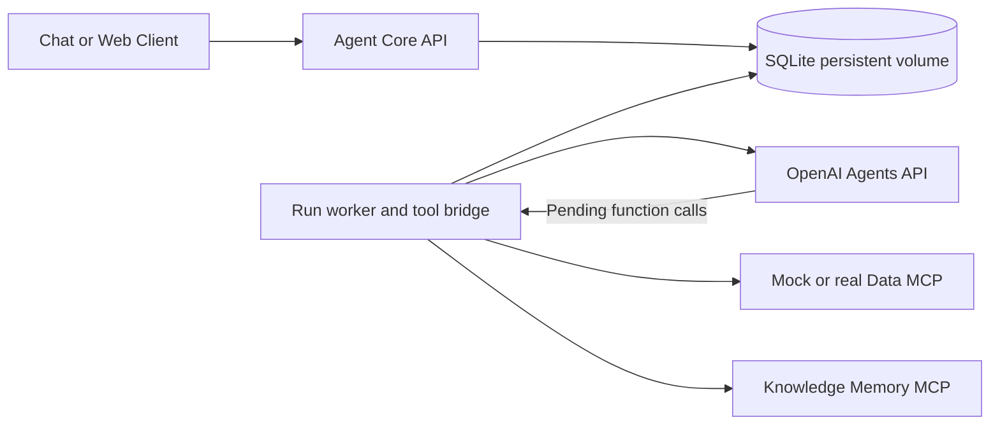

# Agent Core Template Spec

Status: Conversation/tool baseline implemented; T05–T08 hosted modules integrated offline; live acceptance pending. Date: 2026-10-31.

The [Managed Codex Harness and OpenAI-hosted Runtime Extension](agents_api_managed_runtime_spec.md) is normative for the next milestone (T05–T08, AC15–AC22). Existing T01–T04 completion applies only to the baseline described below.

> Alignment note: this document records the earlier starter implementation. The confirmed target
> makes agent-core a reusable agents-service boilerplate invoked by the product server during user
> registration, with dedicated per-user OpenAI-hosted teams. Shop-shared configuration, deferred
> sandboxes/specialists, and polling-only delivery below are not target product decisions. Follow
> the [integration checklist](../../docs/agent-integration.md) to reconcile contracts and consumers together; this note
> does not change the implemented API or claim live acceptance.


This spec defines a ShopOps backend starter using the **OpenAI Agents API**, supporting development with mock MCP services and configuration-based integration with real services. The first deliverable is an end-to-end conversation API with persistence, shop-scoped authorization, and data retrieval with source references.

Inputs: [basic requirements](agents_api_template_requirements.md), [sketch descriptions](imported_sketches_description.md), and the [ShopOps product direction](../../README.md). The technical choices below are proposed template decisions; unclear sketch labels are not treated as confirmed requirements.

## 1. Technology and scope

### 1.1. Platform decisions

| Area | Template choice |
| --- | --- |
| Application API | Python FastAPI, based on `template/python-fastapi` |
| Agent runtime | Managed Codex Harness through OpenAI Agents API and the official `openai` package |
| Execution environment | Baseline `none`; new hosted profile `openai_hosted` per the runtime extension |
| Provider adapter | `openai_agents` for live integration; `fake` for offline tests |
| Initial persistence | SQLite on local disk with a persistent volume; one replica and one application worker |
| Request processing | Asynchronous, with durable runs in the database and a worker loop within the service |
| Client result delivery | Run and event polling; client-facing SSE is deferred |
| Tool integration | Application function tools calling internal MCP services through a bridge |
| Knowledge | Versioned Markdown/JSON bundles with deterministic search for the MVP |
| Deployment | One `agent-core` service on port 8000, using the shared repository pipeline |

The Agents API manages sessions and the agent harness. The application owns identity, authorization, conversation mappings, persistence, and tool handlers. Rebuilding the agent loop with the Agents SDK or Responses API is outside this scope. [Agents API overview](https://developers.openai.com/api/docs/guides/agents-api/overview)

The implementation must use an SDK version that exposes `beta.agents`; pin a verified version in `requirements.txt`. Read the model from `OPENAI_MODEL` without a hardcoded default. Live integration requires an API key with `api.agents.read`, `api.agents.write`, and `api.responses.write` permissions; the SDK handles the beta header as documented. [Quickstart](https://developers.openai.com/api/docs/guides/agents-api/quickstart)

### 1.2. Required functionality

- Provision orchestrator configuration for a shop idempotently.
- Create a separate conversation for each user within a shop and continue the same provider session.
- Accept messages, run the agent, and expose progress, results, and history.
- Retrieve data from the mock Data MCP; search sample knowledge and history through the Knowledge–Memory MCP.
- Ask follow-up questions when the required date range, product, or other information is missing.
- Answer users in Vietnamese, cite data/knowledge sources, and distinguish hypotheses from conclusions.
- Replace the mock Data MCP with a real endpoint for new conversations while preserving the tool contract.
- Preserve the baseline single-orchestrator profile; add real harness delegation, hosted code execution, approved skills, and artifacts under the runtime extension.

### 1.3. Deferred functionality

Telegram/web clients, phone authentication, shop CRUD, connectors/ETL/Data Mart, proactive monitoring, incident lifecycle, approval/execution against real shops, verification, and progressive autonomy belong to later integrations.

The original MVP delivered the three scenarios as tool capabilities and deferred live specialists and sandbox execution. That baseline is complete; actual specialist delegation, hosted code execution, approved skills and artifacts are now required by the [runtime extension](agents_api_managed_runtime_spec.md), with separate acceptance AC15–AC22. Arbitrary user-controlled skills/plugins, a vector database, and long-term memory across conversations remain deferred.

## 2. Architecture and integration boundaries



The worker creates or continues sessions and consumes provider events. For a pending function call, it checks permissions and arguments, calls the corresponding MCP service, persists the result, and returns the tool result to the session. The OpenAI API key stays in the application; the agent cannot read environment variables or execute a shell in the service. [Function tools](https://developers.openai.com/api/docs/guides/agents-api/tools/functions)

The MCP fixtures are mounted in the same FastAPI service at `/mcp/data` and `/mcp/knowledge-memory`, using Streamable HTTP. The bridge uses a real MCP client to exercise the protocol. Disable the mock Data MCP when selecting a real endpoint. The MVP Knowledge–Memory MCP is an internal `agent-core` module and does not require a separate deployment by default.

Do not configure OpenAI to call `srv-captain--...` URLs directly. HTTP MCP connections with `connection_origin: service` originate from OpenAI and require an endpoint reachable from there. Environment-originated connections are an alternative when an appropriate executor/sandbox is available; this template uses the application bridge to access the internal cluster. [MCP connections](https://developers.openai.com/api/docs/guides/agents-api/tools/mcp)

Do not expose an arbitrary function proxy: publish only allowlisted tools. A newly discovered MCP tool does not automatically grant the agent additional permissions.

The hosted extension adds an OpenAI-managed sandbox and harness-created specialists behind the OpenAI API boundary. It keeps internal MCP retrieval in the application bridge; private cluster endpoints are not made reachable from the sandbox. See the [runtime boundaries and subagent constraints](agents_api_managed_runtime_spec.md#4-workspace-bundle-and-actual-specialist-execution).

## 3. Identity and authorization

Keep three identities distinct: `tenant_id` identifies the organization, `shop_id` identifies the shop, and `user_id` identifies the user. Initial fixtures may contain one shop per tenant, but the schema must not equate these concepts.

The auth adapter returns `AuthContext(tenant_id, user_id, shop_ids, permissions)`. The API checks shop membership before processing. Never derive identity from prompts or unverified identity headers.

- `AUTH_MODE=fixture`: mock tokens map to server-side fixtures; local/test only.
- `AUTH_MODE=jwt`: verify signatures through JWKS, issuer, audience, expiry, and required claims. The template profile uses `tenant_id`, `sub`, `shop_ids`, and `permissions`; the real contract can be adapted through the auth adapter.
- Outside `APP_ENV=local|test`, reject startup with fixture authentication or the fake provider.
- Standard permissions: `orchestrator:provision`, `conversation:write`, and `history:read`.
- A conversation is accessible only when its tenant, shop, and owner user match; conversation sharing is outside the MVP.
- Return `404` for resources outside the caller's scope; return `403` for insufficient permissions on an operation within scope.

MCP services receive short-lived credentials bound to the tenant/shop/user/conversation, issued by the bridge from the stored AuthContext. The model does not supply the scope. Each MCP service must validate the credentials and restrict queries accordingly. An incompatible credential mechanism in a real service is an integration issue that must be resolved before enabling that endpoint.

The authentication system/client maps phone numbers and Telegram IDs to users; `agent-core` does not use phone numbers as identity keys.

## 4. Data model

Tables use application UUIDs, UTC timestamps, and appropriate foreign keys. Enforce tenant/shop/user scope in repositories as well as routes.

| Entity | Main fields and constraints |
| --- | --- |
| Orchestrator | `id`, `tenant_id`, `shop_id`, `config_revision`; unique `(tenant_id, shop_id)` |
| ConfigRevision | `id`, `orchestrator_id`, template/version, model, knowledge bundle/version, MCP profile/version, capability profile; immutable |
| Conversation | `id`, orchestrator/config revision, tenant/shop/user, nullable `provider_session_id`, status, timestamps |
| Message | `id`, conversation, role, content, run ID, sequence, nullable provider item ID |
| Run | `id`, conversation, `client_message_id`, request hash, state, provider turn ID, submission marker, deadline, error, config snapshot |
| RunEvent | `id`, run, sequence, event type, sanitized payload; unique `(run_id, sequence)` and provider event ID when available |
| ToolCall | Run/turn/call ID, tool, validated arguments, sanitized result, delivery state; unique provider turn/call ID |

Create the provider session lazily on the first message and reuse it within the conversation. Never share sessions across conversations or users. An orchestrator is shared shop configuration, not a shared container or provider session.

Application history stores completed user/assistant messages; the provider session retains agent execution context. Use provider item IDs to deduplicate messages during reconciliation. Do not expose chain of thought or raw provider payloads through the history API.

Pin the config revision when creating a conversation; configuration changes apply only to new conversations. Deploy revision configuration and provision with the new revision; clients cannot submit arbitrary instructions, models, or MCP URLs.

## 5. Application API

Use the `/api/v1` prefix, Pydantic schemas, and OpenAPI. All business endpoints require a bearer token.

| Method and path | Input | Result |
| --- | --- | --- |
| `POST /shops/{shop_id}/orchestrator` | Server-registered `template_id`, `config_revision` | `201` on creation, `200` if the same revision already exists; return `orchestrator_id` and revision |
| `POST /shops/{shop_id}/conversations` | `orchestrator_id`, `client_conversation_id` | `201` with `conversation_id`; replaying the same input returns `200` with the same ID |
| `POST /conversations/{id}/messages` | `client_message_id`, `content` | `202` with message ID, run ID, and polling URL; replay returns the same run |
| `GET /runs/{id}` | None | Status, final response when available, sources, and error |
| `GET /runs/{id}/events` | `after`, `limit` | Events ordered by sequence and `next_cursor` |
| `GET /conversations/{id}/history` | `after`, `limit` | User/assistant messages within scope |
| `GET /health` | None | Liveness; does not call OpenAI |
| `GET /ready` | None | Config, database, and worker heartbeat checks; `503` when not ready |

Concurrent provisioning must rely on a unique constraint. If the shop already has an orchestrator with a different revision, return `409 configuration_conflict`; revision updates are administrative operations outside the MVP API.

Conversation creation is idempotent on `(tenant_id, shop_id, user_id, client_conversation_id)`. Messages are unique on `(conversation_id, client_message_id)`. Reusing a key with a different payload returns `409 idempotency_conflict`. Check for replay before checking whether the conversation is busy.

Messages contain 1–8000 plain-text characters after trimming; the maximum request body size is 64 KiB. Client IDs are limited to 128 characters. `limit` ranges from 1–100, defaulting to 50. Cursors are opaque and scope-validated; do not use unbounded offsets.

Example message submission:

```json
{
  "client_message_id": "demo-message-001",
  "content": "How did the return rate for SKU-A change last week?"
}
```

Example run result using the application schema, not the OpenAI payload. The text below is translated for this spec; user-facing responses follow the Vietnamese-language requirement in Section 1.2.

```json
{
  "run_id": "run-example",
  "status": "completed",
  "response": {
    "kind": "answer",
    "text": "The return rate increased from 5% to 15%, a rise of 10 percentage points.",
    "sources": [
      {"type": "data", "reference": "fixture:returns-v1:SKU-A"}
    ]
  },
  "error": null
}
```

`response.kind` supports `answer`, `clarification`, and `cannot_answer`. Store a clarification as a completed assistant message; the user's next reply creates a new run in the same session.

Error envelope: `{"error":{"code":"...","message":"...","retryable":false},"request_id":"..."}`. HTTP errors include `401`, `403`, `404`, `409`, `422`, `429`, and `503`. After a `202` response, report execution failures in the run/events; do not present a failed execution as a successful answer with HTTP `200`.

## 6. Run lifecycle and recovery

Application states: `queued → running ↔ waiting_tool → completed|failed|cancelled`; transport failures with uncertain outcomes transition to `reconciling`. Keep the conversation locked in `reconciling` until provider state is established. Allow only one nonterminal run per conversation; reject a new message with `409 conversation_busy` to avoid unintentionally steering an active turn.

A provider turn is one cycle of work; input sent during an active turn can steer it. Check both the local lock and provider state before submission. [Run and continue sessions](https://developers.openai.com/api/docs/guides/agents-api/sessions)

1. In one transaction, persist the user message and durable run, and lock the conversation. Return `202` after commit.
2. The worker claims a run through a database transaction. On first input, create the session with that input and correlation metadata, then atomically save its mapping and initial-input receipt; do not submit the same first message again.
3. For subsequent input, subscribe before submission when supported, persist the submission marker, and correlate the new root turn. First-input streaming may attach after creation; in both cases reconcile saved provider state if events were missed.
4. When the provider requests a function, execute only a pending call in `required_actions`; validate arguments, permissions, and the allowlist before calling MCP.
5. Persist the tool result before returning it to the provider; use turn/call IDs for replay handling and recovery.
6. Finish an application run only when the root turn completes or fails; subagent events do not independently finish the root run. Deduplicate synchronized assistant results by provider item ID.
7. After a restart or stream loss, read provider sessions/items/pending actions to reconcile; do not resubmit user messages solely because the stream closed.

A provider stream can close before a turn ends; retrieve saved state to recover. [Events and items](https://developers.openai.com/api/docs/guides/agents-api/sessions/events)

Do not claim exactly-once execution across the database and OpenAI. If session creation or input submission times out with an unknown provider outcome, mark the run `reconciling` instead of automatically creating another session/turn. The worker attempts to reconcile saved state; when the recovery deadline expires, mark the run `failed` with `provider_outcome_unknown` and leave the conversation `blocked` for administrative review. The user can create a new conversation; do not continue a session with an unresolved turn outcome.

Default deadline: 180 seconds. MCP timeout: 15 seconds per call. Maximum: 8 tool calls per run and 4 concurrent runs across the service. The worker enforces these limits. On timeout, request cancellation if the turn is still active and confirm its state through reconciliation before unlocking the conversation.

Retry read-only MCP calls at most twice for timeouts, connection errors, or transient upstream errors. Do not retry permission or validation errors. Retry provider mutations only when the API in use confirms an idempotency mechanism; reconcile first by default.

Application events include `run.queued`, `run.started`, `tool.started`, `tool.completed`, `tool.failed`, `run.reconciling`, `run.completed`, `run.failed`, and `run.cancelled`. Publish only status, tool names, and permitted content; do not forward raw provider events to clients.

## 7. Tool contracts and sample data

Store versioned JSON Schema contracts in `contracts/`. The bridge publishes corresponding function schemas to the agent and maps them to fixed MCP tool names. Inject scope, credentials, and knowledge versions server-side; the model cannot override them.

| Function and MCP tool | Model-supplied arguments | Main result |
| --- | --- | --- |
| `get_return_metrics` | `sku`, `start_date`, `end_date` | Orders, returns, return rate, baseline, source reference, observed time |
| `get_review_summary` | `sku`, `start_date`, `end_date` | Complaint categories, counts, evidence references |
| `search_knowledge` | `query`, `limit` | Document/chunk ID, excerpt, bundle/version |
| `get_conversation_history` | `before_sequence`, `limit` | Messages from the current conversation within the user's permissions |

Dates are inclusive ISO dates in the shop timezone, `Asia/Ho_Chi_Minh`; require `start_date <= end_date` and a maximum range of 90 days. SKUs contain 1–64 characters. Limit results to 20 items and 32 KiB per call. Tools do not accept SQL, filesystem paths, URLs, or arbitrary tool names from the model.

Successful MCP results contain `schema_version`, `data`, `sources`, and `observed_at`. Error codes include `invalid_input`, `not_found`, `permission_denied`, `upstream_unavailable`, and `timeout`. The bridge normalizes MCP protocol errors and tool errors into the error contract before returning a failed function result.

Distinguish `not_found` from an empty dataset and a connection failure. The assistant must not interpret missing figures as zero or invent sources. References returned to clients must exist in the run's persisted tool results; invalid sources fail output validation. The provider adapter normalizes results into the application response schema regardless of whether the provider supports that output schema directly.

The `returns-v1` fixture contains two shops and at least two users for isolation checks. Demo shop A, SKU-A: baseline of 100 orders/5 returns; current period of 100 orders/15 returns. Sample reviews include sizing complaints; knowledge explains the handling policy. Calculate rates in code from source figures. Use absolute dates in fixtures and demo scripts rather than depending on the execution date.

Each knowledge bundle includes a manifest with `id`, `version`, checksum, and document list. Bundles are immutable; lexical search is sufficient for the MVP, and embeddings are optional. The Memory MCP exposes authorized history, not unrestricted agent write/delete access.

## 8. Configuration and runtime modes

| Variable | Value or requirement |
| --- | --- |
| `APP_ENV` | `local`, `test`, `develop`, `production` |
| `PORT` | `8000` |
| `AGENT_PROVIDER` | Explicitly select `fake` or `openai_agents` |
| `OPENAI_API_KEY` | Required for the live provider; supplied only through runtime secrets |
| `OPENAI_MODEL` | Required for the live provider; a model supported by the account |
| `DATABASE_URL` | Local: `sqlite:///./data/agent-core.db`; CapRover: `sqlite:////data/agent-core.db` |
| `AUTH_MODE` | `fixture` or `jwt` |
| `AUTH_JWKS_URL`, `AUTH_ISSUER`, `AUTH_AUDIENCE` | Required in JWT mode |
| `CONFIG_PATH` | Registry file for templates, revisions, knowledge, and MCP profiles |
| `DATA_MCP_MODE` | `mock` or `remote` |
| `DATA_MCP_URL` | Local mock: `http://127.0.0.1:8000/mcp/data`; required in remote mode |
| `KNOWLEDGE_MEMORY_MCP_URL` | Local: `http://127.0.0.1:8000/mcp/knowledge-memory` |
| `MCP_TOKEN_SIGNING_KEY` | Secret for signing scoped tokens; never stored in the database/config bundle |
| `RUN_TIMEOUT_SECONDS` | `180` |
| `MCP_TIMEOUT_SECONDS` | `15` |
| `MAX_TOOL_CALLS_PER_RUN` | `8` |
| `MAX_CONCURRENT_RUNS` | `4` |

Every variable added during implementation must appear in `.env.example` and the README. Leave secrets empty or use clear placeholders. Missing required variables must fail startup with the variable name, without printing its value.

Distinguish two demo modes: offline uses the fake provider and MCP fixtures; live uses the real Agents API and MCP fixtures. Both use the same application API/schema; only the live demo demonstrates successful OpenAI integration.

Read MCP URLs only from allowlisted administrative configuration. Block non-HTTP(S) schemes, redirects to unapproved hosts, and access to metadata endpoints. Pin the profile within each conversation; endpoint changes affect only new conversations.

## 9. Source structure and deployment

```text
services/agent-core/
  app/
    main.py
    api/                 # Routes and Pydantic schemas
    auth/                # AuthContext, fixture/JWT adapters
    config/              # Settings, registry, and revision validation
    agents/              # Instructions, capability registry, delegation extension
    providers/           # openai_agents and fake through the same interface
    runs/                # Durable worker, state transitions, recovery
    tools/               # Scoped function bridge and MCP client
    mcp/                 # Mock Data and Knowledge Memory servers
    storage/             # Repositories, schema migrations
  config/                # Sample registry without secrets
  knowledge/             # Versioned bundles and manifests
  fixtures/              # Synthetic identities and business data
  contracts/             # API/tool examples and versioned JSON Schemas
  scripts/               # Offline/live demos and cleanup
  tests/
  AGENTS.md
  README.md
  .env.example
  service.json
  Dockerfile
  Makefile
  requirements.txt
  requirements-dev.txt
```

The provider interface separates session creation/inspection, input submission, turn observation, pending tool result handling, cancellation, and session deletion. Provider IDs do not become application resource IDs.

Declare `stack: python` and `port: 8000` in `service.json`. `make ci` runs lint, format checks, and offline tests; live tests use a separate command so default CI does not depend on OpenAI. Follow the current template/CI Python runtime; pin and verify dependencies against it.

The Dockerfile must copy required config, knowledge, and fixtures outside `app/`, run as non-root, and make `/data` writable by the application user. Mount a persistent volume at `/data` in CapRover. Use SQLite WAL, a busy timeout, and short transactions; run database migrations before accepting traffic. Use one instance and prevent two deployed versions from accessing the same database concurrently. Multiple replicas require a shared database and shared run-claiming/locking mechanisms.

If Data MCP later becomes a `data-mcp` service, set the development runtime URL to `http://srv-captain--data-mcp-dev:<port>` through `DATA_MCP_URL`; production must target the corresponding production app, without a development fallback or public-domain URL. Do not expose the two internal MCP routes through public ingress. Prefer an internal `agent-core` deployment called by client backends over the cluster network.

Use the existing deployment pipeline. Development requires the `agent-core-dev` app, `AGENT_CORE_DEV_APP_NAME`, `AGENT_CORE_DEV_CAPROVER_TOKEN`, and shared `CAPROVER_SERVER`. Production uses the corresponding names and secrets. This spec does not establish that those resources already exist.

## 10. Logs and stored data

JSON logs contain only request/run correlation IDs, status, tool names, latency, and sanitized error codes. Do not log prompts, outputs, tool arguments/results, bearer tokens, API keys, or personal identity data. Store conversation content only in authorized persistence; logs are not conversation history.

Minimum metrics: run counts by status, queue delay, run/tool latency, and provider/MCP error counts. Use worker heartbeats for readiness. Configure local history/event retention and provide an administrative command to delete a conversation and its provider session. Validate scope and record cleanup status; do not report successful deletion if provider deletion fails.

The Agents API retains session state. At the referenced documentation version, data residency is limited to the US and ZDR is unsupported. Live demos use synthetic data; use of real shop data must be checked against the system's data requirements. [Agents API data controls](https://developers.openai.com/api/docs/guides/agents-api/overview)

## 11. Acceptance criteria

| ID | Scenario | Required evidence |
| --- | --- | --- |
| AC01 | Repeated and concurrent provisioning for the same shop | Exactly one orchestrator; different revisions return a conflict |
| AC02 | Create a conversation and ask follow-up questions | The same provider session within a conversation; separate sessions across conversations/users |
| AC03 | Query SKU-A within the fixture date range | MCP is called; figures show 5% → 15%, a 10 percentage point increase, with a source |
| AC04 | Ask about policy or omit required information | Knowledge includes bundle/version; missing SKU/date triggers an appropriate clarification |
| AC05 | A different user/shop/tenant accesses a known resource ID | Both API and MCP reject access; no history or data leaks across scopes |
| AC06 | Replay a message or submit concurrent messages | Replay returns the same run; different payload conflicts; a new message while busy does not steer the turn |
| AC07 | MCP timeout, denial, empty/missing data, and malformed output | Cases are distinguished; no fabricated data; runs do not hang indefinitely |
| AC08 | Restart after `202`, lose a stream, or recover a pending tool call | Reconcile from database/provider state without duplicate results or automatic duplicate input submission |
| AC09 | Submission times out with an unknown outcome | Explicit reconciliation/blocked state; no automatic new turn |
| AC10 | Change the Data MCP profile | New conversations use the new profile; existing conversations retain their revision |
| AC11 | Restart a container with its volume | Configuration mappings, history, and runs persist |
| AC12 | Run `make ci` offline | Lint/tests pass without an API key or network access beyond loopback |
| AC13 | Run a live Agents API smoke test | Create a real session, complete at least one MCP-backed tool call, preserve follow-up context, and clean up |
| AC14 | Validate JWT/configuration/output security | Reject tokens with an invalid issuer/audience/expiry; reject fixture mode outside local/test; expose no secrets in API responses/logs |

Unit/contract tests focus on authorization, idempotency, state transitions, recovery, and schemas. Live tests must not assert exact model wording; check figures, sources, tool calls, and states. If credentials/permissions/model access are unavailable for AC13, explicitly report live integration as unverified; the fake provider is not a substitute for that evidence.

## 12. Implementation sequence and integration inputs

1. Scaffold the service, schemas, storage, auth fixtures, and fake provider; complete the offline API lifecycle.
2. Add MCP servers/bridge, sample knowledge, and the returns scenario; verify isolation.
3. Add the Agents API adapter, event handling/recovery, and live smoke testing.
4. Complete the JWT adapter, container volume configuration, deployment documentation, and integration contracts for other teams.

Inputs required before enabling live integrations: OpenAI credentials/permissions/model; JWT issuer/JWKS/claims and membership rules; Data MCP endpoint/schema/scoped authentication; and the registry revision used by registration. Teams must confirm whether tenants can have multiple shops and define user permissions. Fixture profiles allow development to proceed without treating those assumptions as agreed decisions.

Baseline completion means offline execution, CI, AC01–AC14 evidence and published API/tool contracts. Full hosted starter completion additionally requires T05–T08 and AC15–AC22 from the runtime extension; prior AC13 evidence does not prove sandbox, skills or delegation. A complete Detect → Approve → Execute → Verify product workflow remains a later integration milestone.
