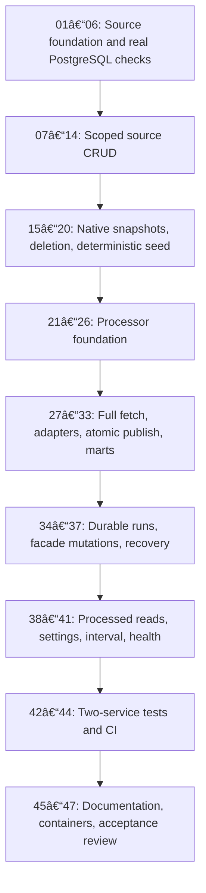

# Implementation plan: mock data and synchronization MVP

Status: approved by the user on 2026-10-31. Implementation in progress. The task checklist is [todo.md](todo.md).

## Objective and scope

Build two internal Python/FastAPI services that exercise source CRUD through
platform-shaped mock responses into PostgreSQL access/raw/core data and eight
calculated mart views. Deliver the approved 10-user, 7-merchant, 21-shop,
140-unique-order seed, with 20 orders visible per user, then expose source CRUD,
processed reads, manual synchronization, job status, and a seconds-based interval
through cronjob-server for the future MCP caller.

Authority: [capability map](../CAPABILITY-MAP.md),
[mock-source spec](../SPEC-mock-source.md),
[data-pipeline spec](../SPEC-data-pipeline.md), and
[sync-control spec](../SPEC-sync-control.md).
Preserve all approved contracts. This plan adds implementation sequencing and
verification mechanics, not new product scope.

No MCP implementation, incident/approval/action audit system, public login,
incremental sync, production deployment, or shared source/database access between
services is included. Minimal run and retry state remains required.

## Repository findings

- There are no existing services to extend. Both services must acquire the Python
  template's application, tests, dependency pins, service metadata, Dockerfile,
  Makefile, and service-local AGENTS.md.
- Python CI selects version 3.14 and runs only `make ci` in each changed service.
  It does not currently provide PostgreSQL.
- Image builds use the service directory as context and copy its `app/` tree.
  Required fixtures and migrations therefore live under that tree.
- Root fixture changes do not automatically select both services for CI. Runtime
  and regression assets must be service-contained; a two-service test workflow
  needs explicit path filters covering both service trees and its own files.
- Existing connector/SQL implementations are useful behavioral references, but
  fixture loaders do not provide runtime migrations, deletion reconciliation,
  durable jobs, or immutable source versions.

## Architecture decisions

| Concern | Implementation direction | Reason |
|---|---|---|
| API contracts | Typed per-resource Pydantic models and concrete registered routes; resource placeholders in specs denote a family of routes | Preserve useful OpenAPI schemas without accepting arbitrary dictionaries or SQL identifiers |
| Source state | Typed `mock.*` tables, monotonic revision, retained mutation receipts, explicit tombstones | One authoritative state for CRUD and coherent raw serialization |
| Source writes | Transaction includes receipt claim, validation, mutation, affected resource revisions, and tombstones | A retry cannot split data changes from their receipt |
| Snapshots | One consistent full read including access, current native/supplement documents, counts, and deletions | Small dataset makes pagination and CDC unnecessary |
| Processor state | Owned `access/raw/core/mart/sync` schemas; full-snapshot validation followed by atomic publication | Consumers see one complete processed dataset |
| Driver | Prefer a pinned Psycopg 3-compatible driver after official compatibility verification | Straightforward PostgreSQL transactions and locks; no ORM required |
| I/O | Synchronous database work stays in sync handlers or an explicit worker thread; async HTTP/worker lifecycle must not block | Follow the template's async safety rules without adding a queue platform |
| Concurrency | One worker/process/replica; PostgreSQL lock and revision recheck under the lock | Prevent stale snapshots from overwriting newer applied state |
| Marts | Package existing SQL views and preserve their thresholds | No materialization or separate refresh jobs |
| CRUD facade | Persist intent before forwarding; retain source receipt and minimum revision; enqueue durable run | Recover source-success/processor-crash cases |
| Time | Fixed business clock; real UTC job times; interval waits use an injectable monotonic clock | Deterministic business results with testable scheduling |
| Identity | Trusted private MCP supplies phone ID; current membership checks scope data; separate trusted admin routes | Match approved MVP identity boundary |
| Testing | Real disposable PostgreSQL, contract tests, and both service containers over HTTP | Prove constraints, rollback, retry, and actual integration |

Verify new package/API assumptions against official documentation when implementing
the relevant task. Reuse the existing pinned template baseline; do not guess new
version pins. Avoid new runtime dependencies for scheduling or retry mechanics.

## Dependency graph and delivery stages



The dependency list on each task is authoritative. Numeric order is the default
execution order; there are no runtime dependencies on the other service's code.
The source module completes before the processor consumes its contract. The
pipeline completes before the control module invokes it.

| Stage | Observable completion | Main verification |
|---|---|---|
| Source foundation | Service runs; migrations and PostgreSQL test isolation work | Health/config/migration tests and service image |
| Source CRUD | All access and business entity routes operate with scoped keys and receipts | Entity HTTP tests, references, concurrent retries |
| Source contract | Stable complete snapshots reflect source edits/deletions; default seed meets counts | Three serializer suites, snapshot consistency, seed manifest |
| Pipeline | Full HTTP snapshot becomes raw/core rows and eight marts | Real PostgreSQL rollback/replay/deletion tests |
| Recovery | Confirmed or ambiguous writes remain traceable to stable runs across restarts | Inject failures before/after source commit and target commit |
| MCP interface | Scoped CRUD and reads, explicit status, interval configuration | Public contract matrix and controlled scheduler clock |
| Integration | Separate containers demonstrate the full flow | End-to-end CRUD and failure scenarios, CI on either service change |
| Handoff | Both service images work independently of repository-root assets | Image smoke checks, docs, requirement traceability |

## Task list and execution discipline

[todo.md](todo.md) contains 47 unchecked tasks with dependencies, expected files,
acceptance criteria, and focused verification commands. Bootstrap work is split
into runtime, build, and metadata patches per service so even scaffolding remains
reviewable. Copy the existing template contents and substitute service names;
do not invent a different scaffold. The resulting metadata must match the
repository's scaffolder conventions.

Each task is S or M (at most five likely files). If implementation reveals more
files or unrelated responsibilities, split the task before changing them and
preserve its dependency/acceptance links. Do not hide large file groups behind
directory wildcards. Existing file names may be refined in the checklist as the
code takes shape, without changing the approved contract.

Write meaningful behavior tests alongside implementation. Add only the checks
needed for the changed behavior; do not add tests merely mirroring trivial code.
Checkpoints after every two or three tasks validate the accumulated slice.
These are execution checks, not repeated permission prompts. Stop only for a
material scope/contract change or an actual external prerequisite.

Implementation starts after this plan/checklist is approved. No task is marked
done merely because its code exists: record the successful verification command
or failure/blocker in the task's evidence field.

## Test environment and commands

Service integration tests use a temporary dedicated PostgreSQL database/server
with test-only credentials generated by the harness. Never use the supplied demo
password or infer a test target from production variables. Keep normal schema
names inside an isolated test database, with independent databases per concurrent
test worker. Reject an unsafe target before migrations or cleanup.

Service-owned test runners start a disposable PostgreSQL container when no
explicitly designated test database is provided. They wait for readiness, inject
test connection settings, run pytest, and remove only resources they created.
Missing Docker/PostgreSQL is a failing prerequisite, not a skipped integration
suite. Check the available local toolchain during implementation; do not silently
replace PostgreSQL with SQLite or PGlite.

Full commands below are planned interfaces, unavailable until the corresponding
tasks implement them. POSIX/WSL commands run from the named service directory:

```sh
make install
make test TEST_ARGS="tests/test_access.py -q"
make lint
make ci
docker build -t mock-data-server .
```

For cronjob-server use its named tests and image tag. `make test` supplies the
isolated database before invoking pytest; tests never require real demo secrets.
The final pair harness runs from the repository root:

```sh
python scripts/test-mock-pipeline.py --suite crud
python scripts/test-mock-pipeline.py --suite recovery
python scripts/test-mock-pipeline.py --suite all
```

The pair harness builds both images, starts them with an isolated PostgreSQL
instance and private test network, migrates/seeds explicitly, uses real HTTP,
and tears down only its own labeled resources. It must not import the sibling
service as an in-process dependency. Runtime containers need only their own
service code; test images/harness assets may access both build contexts.

## CI and build integration

Keep the existing reusable `_ci.yml` and per-service `make ci` convention.
Each service's test runner provisions its own test database under that convention.

Add one narrow `.github/workflows/mock-pipeline-e2e.yml` in task 44 to run the pair
harness for PRs into develop/main when either service, the harness, its Compose
file, or the workflow changes. Use read-only repository permissions, no production
secrets, no deploy step, and concurrency cancellation for superseded PR runs.
This explicitly proposed integration workflow is part of plan review; no workflow
is being changed in this planning task.

Build contexts remain service-local, both container ports remain 8000, source and
processor local host ports differ, and runtime env vars belong in CapRover App
Configs. Images package migration/seed commands. Startup checks migrations and
does not seed or reset automatically.

## Risks and mitigations

| Risk | Consequence | Planned evidence/mitigation |
|---|---|---|
| Twenty visible orders mistaken for twenty per table or 200 unique orders | Wrong seed and access counts | Task 20 asserts 10/7/21/140 plus exactly 20 visible per user |
| Canonical CRUD cannot round-trip native order/item fields | Lost fields or impossible status combinations | Tasks 11, 15–18, 28–29 test native fields, discounts, quantities, full Shopify IDs |
| Source outcome unknown after timeout | Duplicate mutation or missing sync | Transactional receipts in 07; persisted intent and crash recovery in 36–37 |
| Snapshot changes during export or stale revision applies last | Internally inconsistent or regressed processed data | Consistent export in 18; revision recheck inside apply lock in 30 |
| Deletion is inferred from missing/failed data | Data loss or dangling references | Explicit tombstone tests in 19/31 and rollback on unexplained absence |
| Global sync exposes other merchants through counts/errors | Cross-merchant data disclosure | Current source grants plus target ownership in 38–39; negative tests in 43 |
| Small dataset does not trigger all rules | False impression transformations are incomplete | Separate 1,344-order/29-candidate regression suite in 33 |
| Shared PostgreSQL settings collide with existing schemas | Unintended writes to other data | Isolated local/test database; versioned owned schemas; no blanket reset |
| Test failures disappear when PostgreSQL is absent | Unverified transactional behavior | Test runners fail closed; pair workflow uses real containers |
| Python/driver or Docker packaging mismatch | CI/image differs from local tests | Verify dependency compatibility early; build with service-only contexts |
| Source unavailable while processed data exists | Stale access grants authorize reads | Fail user-scoped access checks with 503; test explicitly |
| Frozen clock is replaced by wall clock | Demo results age out or fluctuate | Frozen default/business-time tests and separate scheduling clock |

## Parallelization opportunities

Default execution is sequential; no agents or parallel sessions are started by
this plan. With explicit future delegation, serializers 15–17 and adapter mapping
tests can be isolated after shared contracts stabilize. Changes to migrations,
resource registration, dependency files, receipts, and worker lifecycle must
remain coordinated/sequential. Contract providers must land before consumers.

## Completion and handoff

Final acceptance requires both `make ci` commands, both service-local Docker
builds, and the two-service CRUD/recovery suite to pass. Evidence must cover all
entities, all eight views, exact seed counts, unchanged replay, explicit deletion,
current membership filtering, stable run IDs, restart recovery, interval behavior,
and the separate full-scenario regression counts.

Record remaining limitations honestly: trusted internal identity, one worker,
global atomic sync, frozen clock, observation-point raw history, no production
auth/MCP/incident system. Reviews follow repository guidelines, including
Vietnamese review comments and scoped conventional commits. No automatic merge
or deployment is authorized by this planning request.

## Open inputs and approval

No business question blocks implementation planning. PostgreSQL host/port/TLS and
confirmation of fresh destination schemas are needed only for deployment to the
user's database; local development and tests use disposable databases.

Approval requested for this implementation plan and its proposed task checklist,
including the narrowly scoped integration workflow. After approval, begin task 01
and preserve the approved specification contracts.
